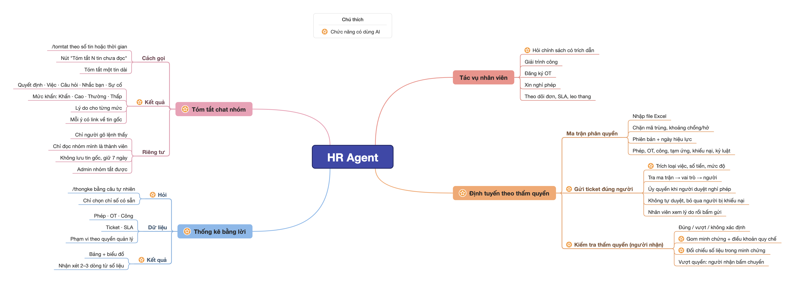
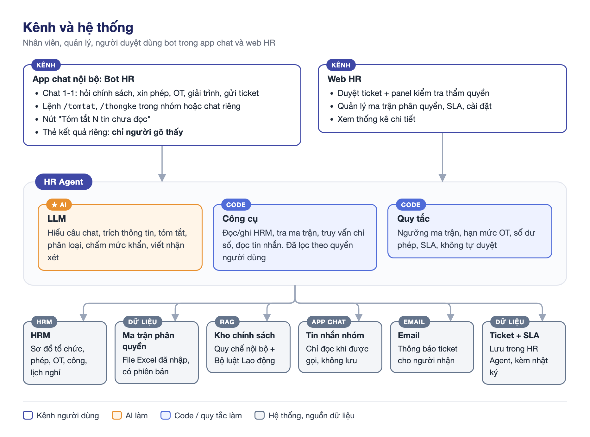
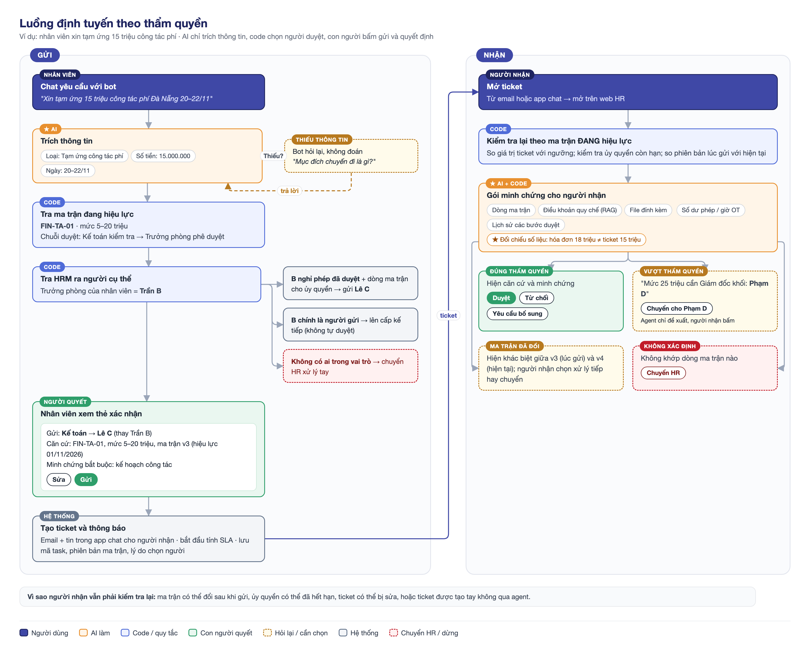
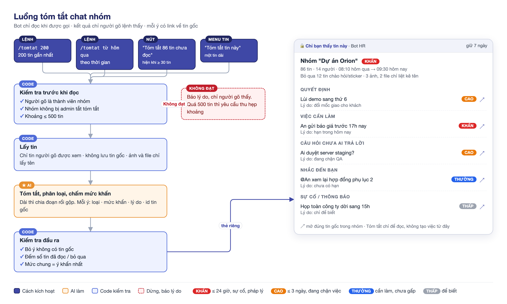
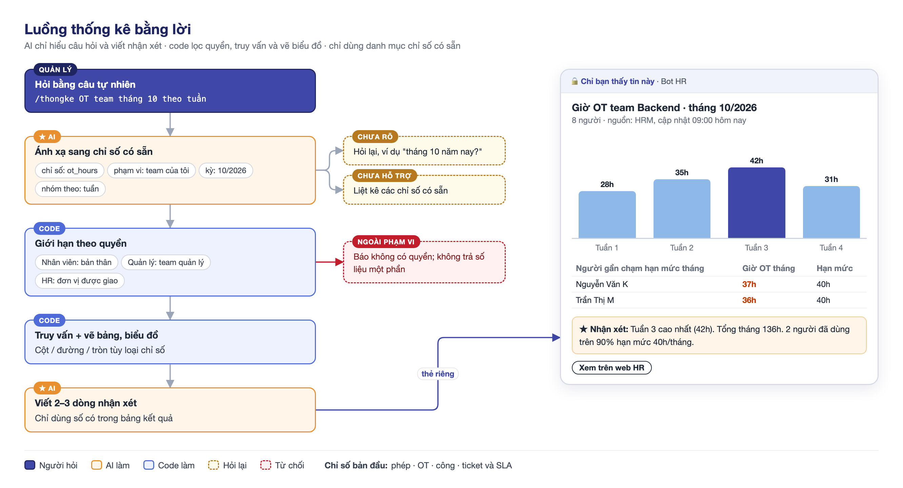

# HR Agent: chốt luồng và scope

> **Trạng thái:** đã chốt qua 3 vòng brainstorm ngày 17/11/2026, chờ review.
> **Phạm vi:** 4 nhóm tính năng: tác vụ nhân viên, định tuyến theo thẩm quyền, trợ lý đọc nhanh, thống kê bằng lời.
> **Bước sau:** use case → user story ([hr-agent-user-stories.md](hr-agent-user-stories.md)) → màn hình.

---

## 1. Mục tiêu

| Ai | Vấn đề | HR Agent giúp gì |
|---|---|---|
| Nhân viên | Không biết gửi đơn cho ai; phải điền nhiều biểu mẫu | Chat một câu; agent tìm đúng người duyệt theo ma trận phân quyền |
| Người duyệt | Nhận đơn không thuộc thẩm quyền; phải tự đi tìm quy chế và minh chứng | Agent kiểm tra thẩm quyền và gom sẵn căn cứ, minh chứng |
| Quản lý | Nhóm chat quá dài, dễ bỏ sót việc gấp; muốn xem số liệu team nhanh | Tóm tắt riêng có phân loại, mức khẩn, link tin gốc; hỏi số liệu nhận về biểu đồ |

---

## 2. Mind map

```text
HR Agent
├── A. Tác vụ nhân viên
│   ├── F01 Hỏi chính sách có trích dẫn
│   ├── F02 Giải trình công
│   ├── F03 Đăng ký OT
│   ├── F04 Xin nghỉ phép
│   └── F05 Theo dõi đơn, SLA, nhắc, leo thang
├── B. Định tuyến theo thẩm quyền
│   ├── F06 Quản lý ma trận phân quyền (nhập Excel, phiên bản, kiểm lỗi)
│   ├── F07 Gửi ticket đúng người
│   ├── F08 Kiểm tra thẩm quyền phía người nhận + gói minh chứng
│   └── F09 Thêm loại việc có tiền/mức độ: tạm ứng công tác phí, khiếu nại, đề xuất kỷ luật
├── C. Trợ lý đọc nhanh (chỉ người gõ lệnh thấy)
│   ├── F10 Tóm tắt đoạn chat nhóm (gõ lệnh / gợi ý khi nhiều tin chưa đọc)
│   ├── F11 Tóm tắt một tin dài
│   ├── F12 Phân loại + mức khẩn từng ý và mức chung
│   └── F13 Admin nhóm tắt tóm tắt cho nhóm nhạy cảm
└── D. Thống kê bằng lời
    └── F14 Hỏi số liệu phép/OT/công, ticket/SLA → bảng + biểu đồ + nhận xét
```

**Bản màu:**



[Mở bản SVG để phóng to](images/02-hr-agent-mindmap.svg). Mọi sơ đồ trong file này được vẽ bằng HTML ở `images/src/`; muốn sửa thì chỉnh file HTML tương ứng rồi chạy `bash images/src/render.sh`.

---

## 3. Kênh và hệ thống



**Prototype:** app chat được giả lập bằng một màn web, dữ liệu giả lập, ma trận là file Excel mẫu tự dựng (mục 5.2).

---

## 4. Phân chia việc giữa AI và code

| Việc | AI (LLM) | Code / quy tắc | Con người |
|---|---|---|---|
| Hiểu yêu cầu chat | Nhận ra loại việc, trích số tiền, số ngày, mức độ | Kiểm tra định dạng, hỏi lại phần thiếu | Nhân viên xác nhận thông tin |
| Chọn người duyệt | — | Tra ma trận → vai trò → người cụ thể trong HRM → ủy quyền | Nhân viên xem lý do rồi bấm gửi |
| Kiểm tra thẩm quyền | Đọc minh chứng, chỉ chỗ lệch (ví dụ hóa đơn 18 triệu nhưng ticket ghi 15 triệu) | So giá trị ticket với ngưỡng trong ma trận đang hiệu lực | Người nhận duyệt, từ chối hoặc bấm chuyển |
| Tóm tắt chat | Tóm tắt, phân loại, chấm mức khẩn, ghi lý do | Kiểm quyền thành viên, nhóm có tắt không, đếm tin, gắn link tin gốc | Người đọc tự kiểm tra lại qua link |
| Thống kê | Hiểu câu hỏi → chỉ số + tham số; viết 2–3 dòng nhận xét | Lọc theo phạm vi quyền, truy vấn, vẽ biểu đồ | — |

**Nguyên tắc chung:** AI không bao giờ chọn người duyệt, không duyệt, không tự chuyển ticket. Mọi con số AI nói ra phải lấy từ kết quả công cụ trả về.

---

## 5. Nhóm B: Định tuyến theo thẩm quyền

### 5.1 Luồng



Người nhận vẫn cần kiểm tra lại vì ma trận có thể đổi sau khi gửi, ủy quyền có thể đã hết hạn, ticket có thể bị sửa, hoặc ticket được tạo tay không qua agent.

### 5.2 Cấu trúc ma trận (file Excel mẫu tự dựng)

File demo: [data/ma-tran-phan-quyen-mau.xlsx](data/ma-tran-phan-quyen-mau.xlsx), dữ liệu giả lập theo cơ cấu VinSmart Future: 70 dòng, 25 loại việc, 13 dòng riêng theo phòng ban (DevOps, Kinh doanh DN, AI ứng dụng); kèm danh bạ 42 người (email, máy lẻ, tài khoản chat, nghỉ phép, ủy quyền), 13 phòng ban thuộc 4 khối, sheet thử định tuyến ra đúng người và sheet kiểm tra lỗi. Sinh lại bằng `data/src/build_matrix.py`.

| Cột | Ví dụ | Ghi chú |
|---|---|---|
| Mã task | FIN-TA-01 | Duy nhất |
| Tên việc | Tạm ứng công tác phí | AI dùng để nhận ra loại việc |
| Tiêu chí | Số tiền (VND) | Số tiền (VND) / Số ngày / Mức độ / Không có |
| Từ – Đến | 5.000.000 – 20.000.000 | Khoảng nửa mở `[từ, đến)`, không được chồng nhau |
| Kiểm tra | Kế toán | Vai trò, có thể để trống |
| Phê duyệt | Trưởng phòng | Vai trò; tra ra người cụ thể qua HRM |
| Được ủy quyền | Có | Có / Không |
| Minh chứng bắt buộc | Kế hoạch công tác | Danh sách |
| Căn cứ | Quy chế tài chính 05/2025, Điều 8 | Hiển thị cho người nhận |
| SLA (giờ) | 8 | Ghi đè mặc định của F05 |
| Phạm vi áp dụng | Tất cả / PM-OPS | Dòng riêng của phòng ban người gửi được ưu tiên; không có thì dùng dòng "Tất cả" |

**Dòng mẫu cho bản đầu:**

| Mã | Việc | Tiêu chí | Mức → người phê duyệt |
|---|---|---|---|
| HR-LV-01 | Nghỉ phép năm | Số ngày | 1–3: Quản lý trực tiếp · 4–10: Trưởng phòng · >10: Giám đốc khối |
| HR-OT-01 | Làm thêm giờ | Loại ngày | Ngày thường/cuối tuần: Quản lý trực tiếp · Ngày lễ: Trưởng phòng |
| HR-AT-01 | Giải trình công | — | Quản lý trực tiếp xác nhận → Thanh tra duyệt |
| FIN-TA-01 | Tạm ứng công tác phí | Số tiền | <5tr: Quản lý trực tiếp · 5–20tr: Kế toán + Trưởng phòng · 20–100tr: Giám đốc khối · ≥100tr: Tổng giám đốc |
| HR-CP-01 | Khiếu nại, phản ánh | Mức độ | Thấp: HRBP · Trung bình: Trưởng phòng HR · Nghiêm trọng: Giám đốc nhân sự + Pháp chế |
| HR-DS-01 | Đề xuất kỷ luật | Hình thức | Khiển trách: Giám đốc khối · Kéo dài nâng lương / Cách chức / Sa thải: Tổng giám đốc + Hội đồng kỷ luật |

### 5.3 Quy tắc

| Mã | Quy tắc |
|---|---|
| BR01 | Chỉ dùng ma trận đã nhập thành công và đang hiệu lực. Khi nhập, hệ thống chặn file có mã trùng, khoảng chồng nhau, khoảng hở hoặc vai trò không tồn tại |
| BR02 | Mỗi ticket lưu mã task, phiên bản ma trận và lý do chọn người duyệt để truy vết |
| BR03 | Không ai được tự duyệt ticket của chính mình; nếu người duyệt chính là người gửi thì lên cấp kế tiếp |
| BR04 | Khiếu nại liên quan đến chính người duyệt thì bỏ qua người đó và lên cấp kế tiếp; nội dung khiếu nại không gửi cho quản lý trực tiếp |
| BR05 | Người duyệt đang nghỉ phép đã duyệt: gửi người được ủy quyền nếu dòng ma trận cho phép, nếu không thì vẫn gửi người duyệt và tính SLA bình thường |
| BR06 | Mức độ (khiếu nại, kỷ luật) do AI đề xuất, người gửi xác nhận; HR được phân loại lại sau khi nhận |
| BR07 | Vượt thẩm quyền: agent chỉ đề xuất người đúng; người nhận phải bấm chuyển. Mỗi lần chuyển được ghi lịch sử |
| BR08 | Thiếu minh chứng bắt buộc thì vẫn gửi được nhưng ticket gắn nhãn "Thiếu minh chứng" để người nhận thấy |

---

## 6. Nhóm C: Trợ lý đọc nhanh

### 6.1 Luồng



### 6.2 Phân loại và mức khẩn

| Loại | Nhận diện |
|---|---|
| Quyết định | Đã chốt, đã thống nhất |
| Việc cần làm | Có người làm (và hạn nếu có) |
| Câu hỏi chưa trả lời | Có câu hỏi, chưa ai trả lời sau đó |
| Nhắc đến bạn | Có @người gõ hoặc gọi tên |
| Sự cố / Thông báo | Lỗi, sự cố, thông tin chung |

| Mức | Tiêu chí (AI phải ghi lý do) |
|---|---|
| Khẩn | Hạn trong 24 giờ; sự cố đang ảnh hưởng; vấn đề an toàn hoặc pháp lý; cấp trên yêu cầu gấp |
| Cao | Hạn trong 3 ngày; đang chặn việc của người khác |
| Thường | Có hạn xa hơn hoặc cần làm nhưng không gấp |
| Thấp | Chỉ để biết |

### 6.3 Quy tắc

| Mã | Quy tắc |
|---|---|
| BR09 | Bot chỉ đọc tin khi người dùng gọi lệnh hoặc bấm nút; không đọc nền |
| BR10 | Chỉ đọc nhóm mà người gõ là thành viên và chỉ những tin người đó được xem |
| BR11 | Không lưu tin gốc; chỉ lưu bản tóm tắt 7 ngày trong lịch sử của chính người gõ |
| BR12 | Admin nhóm được tắt tóm tắt cho nhóm; khi đó lệnh báo "nhóm đã tắt tóm tắt" |
| BR13 | Mỗi ý phải có link về ít nhất một tin gốc; ý nào không có tin gốc thì không được hiển thị |
| BR14 | Đầu bản tóm tắt luôn ghi số tin, khoảng thời gian và số tin bị bỏ qua, để người đọc biết có đọc thiếu hay không |
| BR15 | Tóm tắt chỉ để đọc; không tạo ticket hay nhắc việc từ bản tóm tắt (đã chốt) |

---

## 7. Nhóm D: Thống kê bằng lời



| Nhóm | Chỉ số bản đầu |
|---|---|
| Phép | Số ngày đã nghỉ, còn lại, đang chờ duyệt; lịch vắng của team |
| OT | Giờ OT theo ngày/tuần/tháng/năm, so với hạn mức; người sắp chạm hạn mức |
| Công | Ngày thiếu công, giải trình đang chờ |
| Ticket và SLA | Số ticket theo loại/trạng thái, đang chờ ai, tỷ lệ đúng hạn, ticket quá hạn |

- BR16: AI không tự viết truy vấn; chỉ chọn trong danh mục chỉ số có sẵn.
- BR17: hỏi ngoài phạm vi quyền thì báo không có quyền, không trả số liệu một phần.

---

## 8. Ngoài scope

| Không làm | Lý do |
|---|---|
| Bot đọc nền mọi nhóm chat | Rủi ro riêng tư |
| Tạo ticket hoặc nhắc việc từ bản tóm tắt | Đã chốt: tóm tắt chỉ để đọc |
| Tóm tắt email | Không chọn ở vòng 1 |
| Agent tự duyệt, tự chuyển ticket | Người nhận phải bấm |
| AI tự viết truy vấn dữ liệu | Khó kiểm soát quyền và độ đúng |
| Thống kê tuyển dụng, headcount, biến động nhân sự | Không chọn cho bản đầu |
| Chatbot ứng viên | Tra trạng thái, đổi lịch qua email là đủ, giá trị AI thấp; nộp bổ sung giấy tờ sẽ làm ở phần AI onboarding |
| Kết nối ma trận thật của công ty | Chưa có file; dùng mẫu tự dựng |

---

## 9. Trường hợp biên cần xử lý

| # | Trường hợp | Xử lý |
|---|---|---|
| 1 | Không có dòng ma trận nào khớp | Báo nhân viên, chuyển HR xử lý tay |
| 2 | Ticket không có số tiền mà dòng ma trận cần số tiền | Hỏi lại, không đoán |
| 3 | Người được ủy quyền cũng vắng | Gửi lên cấp kế tiếp |
| 4 | Ma trận đổi khi ticket đang chờ duyệt | Người nhận thấy khác biệt (F08), quyết định chuyển hay xử lý tiếp |
| 5 | Người duyệt đã nghỉ việc hoặc chuyển đơn vị | HRM là nguồn đúng; không có ai thì chuyển HR |
| 6 | Đoạn chat > 500 tin | Yêu cầu thu hẹp khoảng |
| 7 | Tin bị sửa hoặc xóa sau khi tóm tắt | Link báo "tin đã thay đổi" |
| 8 | Đoạn chat lẫn tiếng Anh, viết tắt | Tóm tắt bằng tiếng Việt, giữ nguyên thuật ngữ |

---

## 10. Phi chức năng

| Mã | Yêu cầu |
|---|---|
| NFR01 | Tóm tắt 200 tin trong ≤ 15 giây; thống kê ≤ 5 giây |
| NFR02 | Mọi quyết định định tuyến có nhật ký: ai gửi, mã task, phiên bản ma trận, người được chọn, lý do |
| NFR03 | Phân quyền dữ liệu áp dụng ở tầng công cụ, không phụ thuộc vào lời nhắc cho AI |
| NFR04 | Dữ liệu cá nhân xử lý theo Luật Bảo vệ dữ liệu cá nhân; mỗi người chỉ thấy dữ liệu trong phạm vi quyền |
| NFR05 | Bot nói rõ mình là AI; không có căn cứ thì nói "chưa đủ thông tin" |

---

## 11. Còn cần hỏi mentor

| # | Câu hỏi | Ảnh hưởng |
|---|---|---|
| 1 | Công ty dùng app chat nội bộ nào? Bot có đọc được tin trong nhóm và gửi tin chỉ một người thấy không? | Tính khả thi của nhóm C |
| 2 | Có ma trận phân quyền thật (hoặc bản rút gọn) để đối chiếu cấu trúc không? | Cột trong file mẫu |
| 3 | Ngưỡng N tin chưa đọc và thời gian giữ bản tóm tắt (đang đề xuất 30 tin, 7 ngày) | Cấu hình |
| 4 | Ticket tạm ứng và kỷ luật có thuộc phạm vi HR Agent không, hay thuộc hệ thống tài chính/pháp chế? | F09 |
