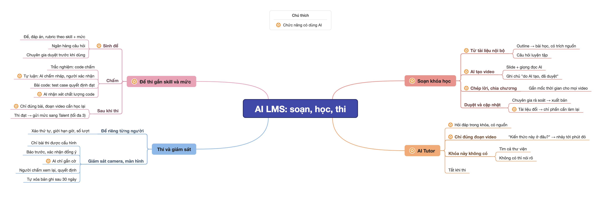
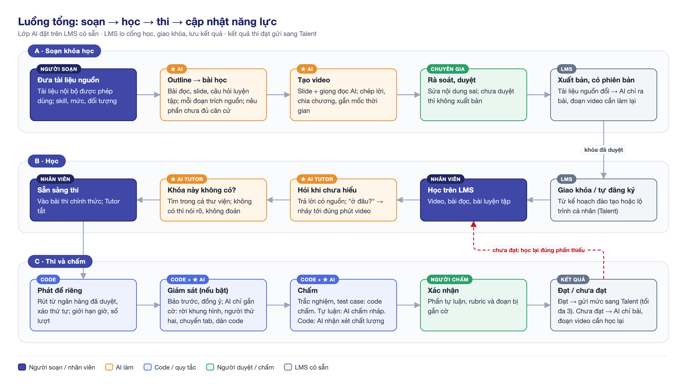
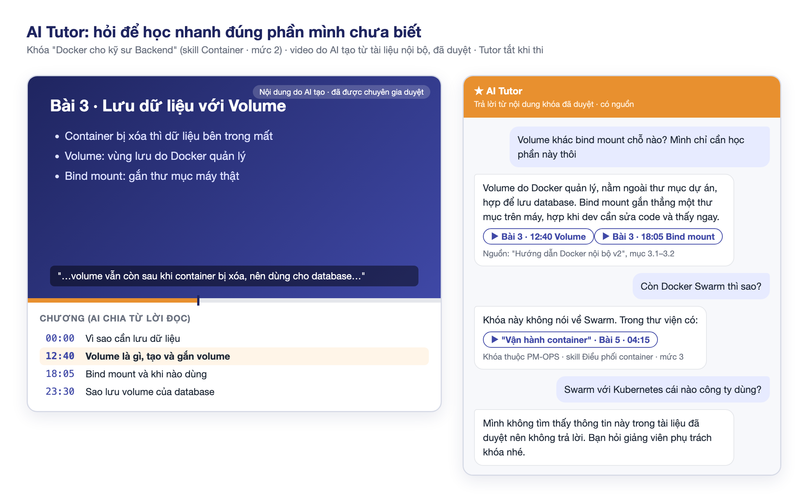

# AI LMS: soạn khóa học, AI Tutor, thi và chấm

> **Trạng thái:** đã chốt qua brainstorm ngày 17/11/2026, chờ review.
> **Phạm vi:** lớp AI đặt trên LMS có sẵn, gồm soạn khóa học (cả video) từ tài liệu, AI Tutor, sinh đề thi gắn skill và mức, chấm, giám sát khi thi. Cổng học, giao khóa và lưu kết quả là việc của LMS có sẵn (mục 10).
> **Bước sau:** user story → màn hình.

---

## 1. Mục tiêu

| Ai | Vấn đề | AI LMS giúp gì |
|---|---|---|
| Phòng đào tạo, người soạn | Chuyển tài liệu nội bộ thành khóa học và video tốn nhiều công; tài liệu đổi thì khó biết phải sửa bài nào | AI soạn bài học và video từ tài liệu, có trích nguồn; tài liệu đổi thì chỉ ra đúng phần cần làm lại |
| Chuyên gia | Phải tự viết đề, đáp án, rubric và chấm tay | AI sinh nháp đề theo skill và mức; tự chấm phần chấm được; chuyên gia chỉ duyệt và xác nhận |
| Nhân viên học | Phải xem cả khóa dù chỉ cần một phần; hỏi thì phải chờ giảng viên | Hỏi AI Tutor, được chỉ đúng phút trong video; thi chưa đạt thì biết đúng phần cần học lại |
| Talent | Cần biết mức skill thật, không chỉ "đã học xong" | Nhận kết quả thi đạt theo skill và mức |

**Nguyên tắc:**
- **Lớp AI trên LMS có sẵn.** Không dựng lại cổng học, giao khóa hay lưu kết quả.
- **Mọi nội dung AI tạo đều có nguồn và phải được duyệt.** Khóa học, video và đề thi chỉ xuất bản sau khi chuyên gia duyệt.
- **Chỗ nào chấm chính xác được thì dùng code.** Trắc nghiệm và test case do code chấm. AI chỉ chấm nháp phần tự luận và nhận xét chất lượng; người chấm xác nhận.
- **AI không tự cho đạt, không tự hủy bài.** Giám sát khi thi chỉ gắn cờ; người chấm quyết định.

---

## 2. Mind map

```text
AI LMS: soạn, học, thi
├── A. Soạn khóa học
│   ├── F01 Từ tài liệu nội bộ → outline → bài học, câu hỏi luyện tập, có trích nguồn
│   ├── F02 AI tạo video: slide + giọng đọc AI
│   ├── F03 Chép lời, chia chương, gắn mốc thời gian cho mọi video
│   ├── F04 Chuyên gia rà soát, duyệt, xuất bản có phiên bản
│   └── F05 Tài liệu nguồn đổi → chỉ ra bài, đoạn video cần làm lại
├── B. AI Tutor
│   ├── F06 Hỏi đáp trong khóa đang học, có nguồn
│   ├── F07 "Kiến thức này ở đâu?" → nhảy tới đúng phút trong video
│   └── F08 Khóa này không có → tìm trong cả thư viện; không có thì nói rõ
├── C. Đề thi gắn skill và mức
│   ├── F09 Sinh nháp đề, đáp án, rubric theo skill + mức; ngân hàng câu hỏi
│   ├── F10 Chấm: trắc nghiệm, test case bằng code; tự luận AI chấm nháp; AI nhận xét code
│   └── F11 Sau thi: chỉ đúng phần cần học lại; thi đạt → gửi mức sang Talent
└── D. Thi và giám sát
    ├── F12 Đề riêng từng người, xáo thứ tự, giới hạn giờ, số lượt; tắt Tutor
    └── F13 Giám sát camera, màn hình; AI chỉ gắn cờ, người chấm quyết định
```

**Bản màu:**



Sơ đồ vẽ bằng HTML ở `images/src/`; sửa file HTML rồi chạy `bash images/src/render.sh`.

---

## 3. Luồng tổng



| Việc | AI | Code / quy tắc | Con người |
|---|---|---|---|
| Soạn bài học | Outline, bài đọc, slide, câu hỏi luyện tập, có trích nguồn | Lưu phiên bản | Người soạn chỉnh; chuyên gia duyệt |
| Tạo video | Lời đọc, giọng đọc AI, ghép slide thành video | — | Chuyên gia duyệt |
| Chép lời, chia chương | Chép lời, chia chương, gắn mốc thời gian | — | Người soạn sửa tên chương nếu cần |
| Tài liệu đổi | So bản cũ và mới, chỉ ra bài và đoạn video bị ảnh hưởng | Phát hiện tài liệu có bản mới | Người soạn cập nhật; chuyên gia duyệt lại |
| Tutor | Trả lời có nguồn, tìm đúng đoạn video | Tắt khi đang thi | Giảng viên trả lời câu Tutor không trả lời được |
| Sinh đề | Đề, đáp án, rubric, test case theo skill + mức | Rút đề riêng, xáo thứ tự | Chuyên gia duyệt đề trước khi dùng |
| Chấm | Chấm nháp tự luận; nhận xét chất lượng code | Chấm trắc nghiệm; chạy test case | Người chấm xác nhận tự luận, rubric, đoạn bị gắn cờ |
| Giám sát | Gắn cờ dấu hiệu bất thường | Bật theo cấu hình bài thi; xóa bản ghi đúng hạn | Người chấm xem lại, quyết định |

---

## 4. Soạn khóa học

### 4.1 Các bước

1. Người soạn đưa tài liệu nguồn được phép dùng, chọn skill, mức khóa đưa tới (theo khung năng lực ở Talent) và đối tượng học.
2. AI đề xuất outline và mục tiêu từng bài; người soạn chỉnh.
3. AI soạn bài đọc, slide và câu hỏi luyện tập. Mỗi đoạn trích nguồn (tài liệu, mục). Chỗ tài liệu không đủ căn cứ thì AI ghi rõ, không tự viết thêm.
4. AI tạo video cho từng bài (mục 4.2).
5. Chuyên gia rà soát nội dung và video. Chưa duyệt thì không xuất bản.
6. Xuất bản lên LMS, có phiên bản. Khóa được gắn sẵn skill và mức đã chọn ở bước 1, nên không cần gắn nhãn lại ở Talent.

### 4.2 Video

| Mục | Cách làm |
|---|---|
| Dạng video | Slide + giọng đọc AI. Avatar AI để sau (mục 10) |
| Giọng đọc | Giọng có sẵn của dịch vụ. Không nhân bản giọng người thật khi người đó chưa đồng ý |
| Ghi chú | Video ghi rõ "Nội dung do AI tạo, đã được chuyên gia duyệt" |
| Sửa | Người soạn sửa lời đọc hoặc slide thì AI tạo lại riêng đoạn đó, không làm lại cả video |
| Chép lời, chia chương | Áp dụng cho **mọi video**, cả video AI tạo và video giảng viên tự quay rồi tải lên. Đây là dữ liệu để Tutor chỉ đúng phút |

### 4.3 Tài liệu nguồn thay đổi

Khi tài liệu nguồn có bản mới, AI so bản cũ với bản mới và liệt kê những bài, đoạn video, câu hỏi đang trích phần bị đổi. Người soạn cập nhật các phần đó, rồi chuyên gia duyệt lại. Trong lúc chờ, khóa vẫn chạy bản cũ nhưng hiện ghi chú "tài liệu nguồn đã có bản mới".

---

## 5. AI Tutor



| Người học hỏi | Tutor làm |
|---|---|
| Hỏi khái niệm trong khóa | Trả lời từ nội dung khóa đã duyệt, kèm nguồn và nút nhảy tới đúng phút video hoặc đúng bài |
| "Mình chỉ cần học phần X" | Chỉ các chương liên quan để xem riêng, không cần xem cả khóa |
| Hỏi thứ khóa này không có | Tìm trong các khóa đã xuất bản khác, chỉ tới đúng khóa, bài, phút |
| Hỏi thứ không có trong tài liệu nào | Nói rõ không tìm thấy, không đoán. Gợi ý hỏi giảng viên phụ trách khóa |

- Tutor chỉ dùng nội dung đã duyệt và người học được phép xem.
- Tutor **tắt trong lúc thi** chính thức.
- Câu hỏi Tutor không trả lời được được gom lại cho người soạn. Đây là dấu hiệu khóa đang thiếu nội dung.

---

## 6. Đề thi và chấm

### 6.1 Dạng bài theo mức

| Mức | Đo cái gì | Dạng bài |
|---|---|---|
| 1 · Biết khái niệm | Hiểu khái niệm | Trắc nghiệm |
| 2 · Làm được khi có hướng dẫn | Áp dụng vào tình huống quen | Trắc nghiệm tình huống + tự luận ngắn |
| 3 · Làm độc lập | Tự giải bài thực tế | Bài code / thực hành + tự luận tình huống |

Mức 4–5 không thi trên LMS; quản lý đánh giá qua dự án (theo Talent).

### 6.2 Sinh đề

1. Chuyên gia chọn skill, mức, tài liệu nguồn, số câu và điểm đạt.
2. AI sinh nháp câu hỏi, đáp án, giải thích, rubric cho tự luận, đề bài code kèm test case. Mỗi câu gắn với nguồn.
3. Chuyên gia duyệt từng câu. Câu đã duyệt mới vào ngân hàng câu hỏi.
4. Mỗi lần thi, code rút đề riêng cho từng người từ ngân hàng và xáo thứ tự.

### 6.3 Chấm

| Dạng | Ai chấm | Ai xác nhận |
|---|---|---|
| Trắc nghiệm | Code | — |
| Tự luận | AI chấm nháp theo rubric, chỉ ra đoạn trả lời ứng với từng tiêu chí | Người chấm |
| Bài code | **Test case quyết định đạt hay không** (code) | — |
| Chất lượng code | AI nhận xét theo rubric: cách đặt tên, cấu trúc, xử lý lỗi | Người chấm, nếu phần rubric có tính điểm |

### 6.4 Sau khi thi

- **Chưa đạt:** AI chỉ ra phần sai thuộc bài nào, đoạn video nào, để người học xem lại đúng chỗ. Được thi lại theo số lượt cấu hình. Hết lượt thì người phụ trách khóa xử lý; hệ thống không tự cho đạt.
- **Đạt:** kết quả chính thức gửi sang Talent, nâng mức skill tương ứng, tối đa mức 3.
- Bài luyện tập không gửi kết quả sang Talent.

---

## 7. Giám sát khi thi

| Quy định | Chi tiết |
|---|---|
| Khi nào bật | Chỉ cho bài thi được cấu hình, ví dụ thi chứng nhận mức 3. Không bật cho bài luyện tập |
| Báo trước | Trước khi vào thi, người thi thấy rõ những gì được ghi lại và phải bấm đồng ý |
| AI chỉ gắn cờ | Rời khỏi khung hình · có người thứ hai · chuyển tab · dán code từ ngoài vào. Mỗi cờ có mốc thời gian để người chấm xem lại đúng đoạn |
| Ai quyết định | Người chấm xem lại đoạn bị gắn cờ rồi quyết định. AI không tự hủy bài, không tự trừ điểm |
| Lưu trữ | Bản ghi tự xóa sau 30 ngày, trừ bài đang được xem xét |

---

## 8. Quy tắc

| Mã | Quy tắc |
|---|---|
| BR01 | Chỉ dùng tài liệu nguồn được phép. Mọi đoạn bài học, câu hỏi và lời đọc video đều trích nguồn |
| BR02 | Khóa học, video và câu hỏi chỉ xuất bản hoặc dùng sau khi chuyên gia duyệt. Nội dung có phiên bản |
| BR03 | Video AI tạo ghi rõ "do AI tạo, đã được chuyên gia duyệt". Không nhân bản giọng người thật khi chưa có đồng ý |
| BR04 | Mọi video được chép lời và chia chương có mốc thời gian |
| BR05 | Tutor chỉ trả lời từ nội dung đã duyệt mà người học được xem; không có thì nói rõ, không đoán |
| BR06 | Tutor tắt trong lúc thi chính thức |
| BR07 | Mỗi người thi một đề riêng rút từ ngân hàng đã duyệt; có giới hạn giờ và số lượt |
| BR08 | Trắc nghiệm và test case do code chấm. Bài code đạt hay không do test case quyết định |
| BR09 | Tự luận do AI chấm nháp, người chấm xác nhận. AI không tự cho đạt |
| BR10 | Chỉ kết quả thi chính thức đạt mới gửi sang Talent, nâng tối đa mức 3. Bài luyện tập không gửi |
| BR11 | Giám sát chỉ bật cho bài thi được cấu hình, phải báo trước và có đồng ý |
| BR12 | AI giám sát chỉ gắn cờ; người chấm quyết định. AI không tự hủy bài, không tự trừ điểm |
| BR13 | Bản ghi giám sát tự xóa sau 30 ngày, trừ bài đang được xem xét |

---

## 9. Trường hợp biên cần xử lý

| # | Trường hợp | Xử lý |
|---|---|---|
| 1 | Tài liệu nguồn mâu thuẫn nhau | AI chỉ ra chỗ mâu thuẫn, không tự chọn; người soạn quyết định |
| 2 | Tài liệu chứa thông tin mật, dữ liệu cá nhân | AI báo trước khi soạn; người soạn xác nhận phạm vi được dùng |
| 3 | Video giảng viên tự quay, chất lượng âm thanh kém | Chép lời vẫn chạy; đoạn không nghe rõ được đánh dấu để người soạn sửa |
| 4 | Câu hỏi trong ngân hàng bị nhiều người sai bất thường | Báo chuyên gia xem lại câu hỏi; có thể câu sai hoặc mơ hồ |
| 5 | Bài code chạy quá thời gian hoặc dùng quá tài nguyên | Dừng, tính là không qua test đó; ghi rõ lý do |
| 6 | Mất mạng giữa giờ thi | Lưu bài liên tục; vào lại thì tiếp tục, thời gian vẫn tính; người phụ trách được gia hạn |
| 7 | Người thi không đồng ý giám sát | Không vào được bài thi có giám sát; trao đổi với người phụ trách để thi hình thức khác |
| 8 | Camera hỏng hoặc không có camera | Ghi nhận; người phụ trách quyết định cho thi hình thức khác hoặc dời lịch |
| 9 | Hai khóa trả lời khác nhau cho cùng một câu Tutor hỏi | Tutor hiện cả hai kèm nguồn, ghi rõ khác nhau; báo người soạn |
| 10 | Tài liệu nguồn đổi khi đang có người thi đề cũ | Bài thi đang làm giữ nguyên đề; câu hỏi bị ảnh hưởng được báo chuyên gia xem lại |

---

## 10. Ngoài scope

| Không làm | Lý do |
|---|---|
| Dựng lại LMS: cổng học, giao khóa, lưu kết quả, chứng chỉ | Dùng LMS có sẵn; chỉ làm lớp AI |
| Đào tạo hội nhập cho nhân viên mới | Phần lớn là quy tắc, ít AI; không nằm trong phạm vi bản này |
| Avatar AI trong video | Để sau; giai đoạn đầu dùng slide + giọng đọc AI |
| Nhân bản giọng người thật khi chưa có đồng ý | Rủi ro pháp lý và đạo đức |
| Thi mức 4–5 trên LMS | Mức 4–5 do quản lý đánh giá qua dự án (Talent) |
| AI tự hủy bài, tự trừ điểm, tự cho đạt | Người chấm quyết định |

**Prototype:** LMS, danh mục khóa và kết quả học dùng dữ liệu giả lập. Giám sát làm dạng mô phỏng: tạo sẵn các cờ để thể hiện màn hình người chấm xem lại.

---

## 11. Phi chức năng

| Mã | Yêu cầu |
|---|---|
| NFR01 | Tutor trả lời trong ≤ 10 giây |
| NFR02 | Kết quả chấm trắc nghiệm và test case có ngay khi nộp bài; tự luận có điểm nháp trong ≤ 1 phút |
| NFR03 | Bài code chạy trong môi trường cách ly, giới hạn thời gian và tài nguyên |
| NFR04 | Bản ghi giám sát mã hóa khi lưu; chỉ người chấm của bài đó xem được |
| NFR05 | Dữ liệu cá nhân xử lý theo Luật Bảo vệ dữ liệu cá nhân; dịch vụ AI không được dùng để huấn luyện |
| NFR06 | Nhật ký: ai duyệt nội dung, đề nào được dùng, ai chấm, ai xem bản ghi giám sát, lúc nào |

---

## 12. Liên quan đến các phần khác

| Phần | Dùng chung |
|---|---|
| Talent | Khung năng lực (skill, mức) để gắn khóa và đề; Talent giao khóa; LMS trả kết quả thi đạt để nâng mức |
| HR Agent | Câu hỏi về khóa học trong bot HR có thể chuyển sang Tutor |
| HRM | Thông tin nhân viên, đơn vị để phân quyền xem khóa |

---

## 13. Còn cần hỏi mentor / phòng đào tạo

| # | Câu hỏi | Ảnh hưởng |
|---|---|---|
| 1 | Công ty đang dùng LMS nào, có API để đọc khóa, giao khóa, ghi kết quả không? | Toàn bộ |
| 2 | Phần soạn khóa có thay Articulate 360 không, hay dùng song song? | Mục 4 |
| 3 | Video cần tiếng Việt, tiếng Anh hay cả hai? | Mục 4.2 |
| 4 | Bài code cần hỗ trợ những ngôn ngữ lập trình nào? | Mục 6, NFR03 |
| 5 | Quy chế thi: điểm đạt, số lượt thi lại, ai được xem bản ghi giám sát? | BR07, BR13 |
| 6 | Có cần xác minh danh tính người thi bằng khuôn mặt không, hay đăng nhập tài khoản công ty là đủ? | Mục 7 |
