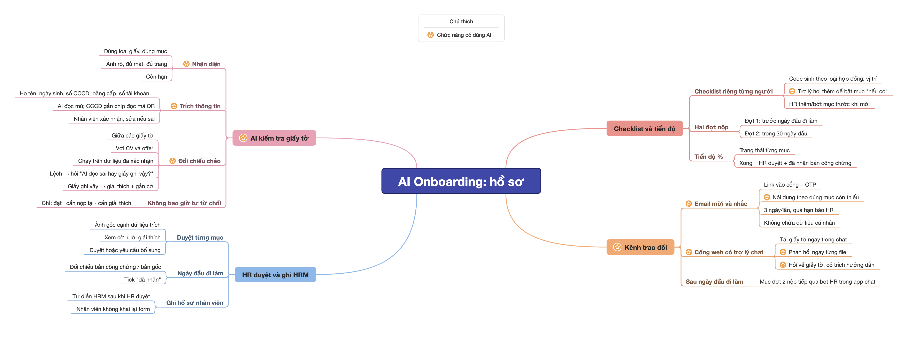
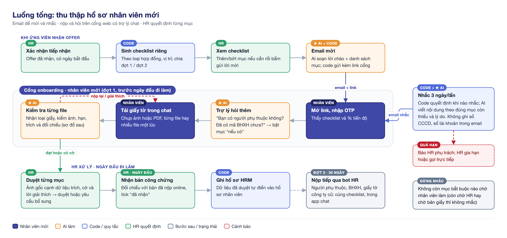
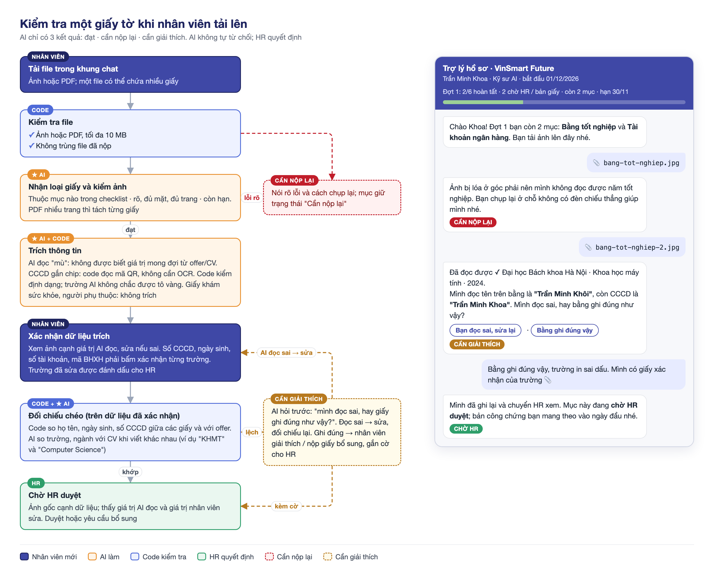

# AI Onboarding: thu thập và kiểm tra hồ sơ

> **Trạng thái:** đã chốt qua 2 vòng brainstorm ngày 17/11/2026, chờ review.
> **Phạm vi:** chỉ phần thu thập, kiểm tra và hoàn thiện hồ sơ của nhân viên mới. Khởi tạo, phân công, đào tạo và kích hoạt nằm ngoài phạm vi (mục 9).
> **Bước sau:** user story ([onboarding-user-stories.md](onboarding-user-stories.md)) → màn hình.

---

## 1. Mục tiêu

| Ai | Vấn đề | AI Onboarding giúp gì |
|---|---|---|
| Nhân viên mới | Không rõ cần nộp gì; nộp sai phải chờ HR báo lại mấy ngày | Có checklist riêng; nộp trong chat và biết ngay file đạt hay phải nộp lại |
| HR onboarding | Mất thời gian đòi giấy, soát từng ảnh, gõ lại thông tin vào HRM | AI đòi đúng mục còn thiếu, soát trước, đối chiếu chéo; HR chỉ duyệt; dữ liệu tự điền vào HRM |

**Nguyên tắc:** chỗ nào quy tắc làm chính xác được thì dùng code. AI chỉ làm phần code không làm được: đọc giấy tờ, đối chiếu khi cách viết khác nhau, trao đổi với nhân viên để bổ sung. AI không bao giờ từ chối hồ sơ; HR là người quyết định.

---

## 2. Mind map

```text
AI Onboarding: hồ sơ
├── A. Checklist và tiến độ
│   ├── F01 Checklist riêng từng người (code sinh; trợ lý hỏi để bật mục "nếu có"; HR thêm/bớt)
│   └── F02 Tiến độ % theo 2 đợt, trạng thái từng mục
├── B. Kênh trao đổi
│   ├── F03 Email mời và nhắc (AI viết nội dung theo mục còn thiếu)
│   ├── F04 Cổng web có trợ lý chat (nộp file, hỏi về giấy tờ)
│   └── F05 Sau ngày đầu: nộp tiếp đợt 2 qua bot HR trong app chat
├── C. AI kiểm tra giấy tờ
│   ├── F06 Nhận loại giấy, kiểm ảnh và hạn dùng
│   ├── F07 Trích thông tin, nhân viên xác nhận
│   └── F08 Đối chiếu chéo trên dữ liệu đã xác nhận; lệch thì hỏi nhân viên và gắn cờ cho HR
└── D. HR duyệt và ghi HRM
    ├── F09 Duyệt từng mục, yêu cầu bổ sung
    ├── F10 Ngày đầu: nhận bản công chứng / bản gốc
    └── F11 Ghi dữ liệu đã duyệt vào hồ sơ nhân viên trong HRM
```

**Bản màu:**



[Mở bản SVG để phóng to](images/onb-mindmap.svg). Sơ đồ vẽ bằng HTML ở `images/src/`; sửa file HTML rồi chạy `bash images/src/render.sh`.

---

## 3. Luồng tổng



**Kênh:**

| Kênh | Dùng để | Vì sao |
|---|---|---|
| Email cá nhân | Mời, nhắc, báo quá hạn; kèm link vào cổng | Trước ngày đầu, nhân viên chưa có tài khoản nội bộ; email là kênh họ chắc chắn có |
| Cổng web có trợ lý chat | Nộp giấy tờ, nhận phản hồi ngay, hỏi đáp | Nộp qua email thì chậm, khó theo dõi % và lộ giấy tờ cá nhân trong hộp thư |
| Bot HR trong app chat | Nộp tiếp các mục đợt 2 sau ngày đầu | Lúc này đã có tài khoản nội bộ; dùng lại bot của HR Agent |

---

## 4. Kiểm tra một giấy tờ



### 4.1 Phân chia việc giữa AI, code và con người

| Việc | AI (LLM có đọc ảnh) | Code / quy tắc | Con người |
|---|---|---|---|
| Sinh checklist | Hỏi nhân viên để bật mục "nếu có" | Sinh mục theo loại hợp đồng, vị trí; chia đợt, tính hạn | HR thêm/bớt mục trước khi mời |
| Nhận file | Nhận loại giấy, tách PDF nhiều giấy, kiểm ảnh rõ, đủ mặt | Định dạng, dung lượng, trùng file | — |
| Hạn dùng | Đọc ngày cấp, ngày hết hạn | So với ngày bắt đầu đi làm | — |
| Trích thông tin | Đọc các trường trên giấy, không được biết giá trị mong đợi | Đọc mã QR trên CCCD gắn chip; kiểm định dạng (CCCD 12 số, ngày hợp lệ) | Nhân viên xác nhận, sửa nếu sai |
| Đối chiếu (sau khi nhân viên xác nhận) | So trường, ngành với CV khi cách viết khác nhau | So họ tên (bỏ dấu, viết hoa), ngày sinh, số CCCD | Nhân viên báo AI đọc sai, hoặc giải thích chỗ lệch |
| Nhắc | Viết nội dung email theo mục còn thiếu | Lịch nhắc, dừng nhắc, báo quá hạn | HR gia hạn |
| Quyết định | — | Tính % tiến độ | HR duyệt từng mục, nhận bản công chứng |

### 4.2 Trạng thái một mục

```text
Chưa nộp ──► Đang kiểm ──┬─► Cần nộp lại ─────► (nộp lại) ──────────────► Đang kiểm
                         ├─► Cần giải thích ──┬─► (AI đọc sai, nhân viên sửa) ─► đối chiếu lại
                         │                    └─► (giấy ghi vậy, giải thích) ──► Chờ HR (có cờ)
                         └─► Chờ HR ──┬─► HR yêu cầu bổ sung (ghi lý do) ──► Cần nộp lại
                                      └─► Đã duyệt online ──► Hoàn tất
                                          (mục cần bản giấy: chỉ Hoàn tất khi HR tick "đã nhận")
```

"Đang kiểm" gồm cả bước chờ nhân viên xác nhận dữ liệu trích. Mục HR duyệt dạng bản tạm (trường hợp biên 5) tính là Đã duyệt online, kèm hạn bổ sung bản chính thức.

**Cổng hiện 2 con số:**
- **% hoàn tất** = số mục bắt buộc ở trạng thái Hoàn tất / tổng số mục bắt buộc của đợt.
- **Phần của nhân viên:** số mục bắt buộc không còn chờ nhân viên làm, tức là đã ở Chờ HR, Đã duyệt online hoặc Hoàn tất.

Trước ngày đầu, các mục cần bản giấy chưa thể Hoàn tất. Vì vậy % hoàn tất của đợt 1 luôn dưới 100%. Nhắc và quá hạn tính theo "phần của nhân viên" (BR07).

### 4.3 Khi AI đọc sai

AI đọc ảnh có thể sai: nhầm số, mất dấu tiếng Việt, đọc nhầm ngày. Nếu đối chiếu trên dữ liệu AI đọc sai, hệ thống sẽ báo lệch giả, hoặc tệ hơn là cho qua một giá trị sai. Thiết kế chặn ở 5 lớp:

| # | Lớp chặn | Chặn được gì |
|---|---|---|
| 1 | **Không dùng OCR khi có nguồn chính xác hơn.** CCCD gắn chip có mã QR chứa số CCCD, họ tên, ngày sinh, giới tính, nơi thường trú; code giải mã QR thì đúng 100%. AI chỉ đọc khi QR mờ | Sai ở giấy quan trọng nhất |
| 2 | **AI đọc "mù".** Không đưa giá trị mong đợi (tên trong offer, ngành trong CV) vào lúc trích, để AI không "đọc cho khớp". Code kiểm định dạng: CCCD 12 số, BHXH 10 số, ngày hợp lệ. Trường AI không chắc được tô vàng | AI tự bịa cho khớp; lỗi định dạng |
| 3 | **Nhân viên xác nhận trước khi đối chiếu.** Ảnh hiện cạnh giá trị đọc được. Số CCCD, ngày sinh, số tài khoản, mã BHXH phải bấm xác nhận từng trường | Phần lớn lỗi đọc, kể cả trường không có gì để đối chiếu như số tài khoản |
| 4 | **Lệch thì hỏi "AI đọc sai hay giấy ghi vậy?" trước khi đòi giải thích.** Đọc sai thì nhân viên sửa rồi đối chiếu lại; chỉ khi giấy thật sự ghi khác mới gắn cờ | Bắt nhân viên giải thích một lỗi không phải của họ |
| 5 | **HR duyệt và bản giấy ngày đầu.** HR thấy ảnh gốc, giá trị AI đọc và giá trị nhân viên sửa. Bản công chứng là chốt chặn cuối | Nhân viên cố sửa cho khớp; lỗi lọt qua cả AI và nhân viên |

Hệ thống ghi lại tỷ lệ trường bị nhân viên sửa theo từng loại giấy để đo độ chính xác của AI. Loại giấy nào bị sửa nhiều thì bật bắt buộc xác nhận từng trường cho loại đó.

---

## 5. Checklist mẫu

| # | Mục | Đợt | Bắt buộc | Bản giấy ngày đầu | AI kiểm / trích |
|---|---|---|---|---|---|
| 1 | CCCD (2 mặt) | 1 | Có | Bản sao công chứng | Còn hạn; đọc mã QR (AI đọc khi QR mờ): họ tên, số CCCD, ngày sinh, giới tính, nơi thường trú |
| 2 | Sơ yếu lý lịch | 1 | Có | — | Đủ trang, có chữ ký; họ tên, ngày sinh khớp CCCD |
| 3 | Bằng tốt nghiệp cao nhất | 1 | Có | Bản sao công chứng | Trường, ngành, năm, xếp loại; khớp CV; tên khớp CCCD |
| 4 | Chứng chỉ theo vị trí (ngoại ngữ, cloud…) | 1 | Theo vị trí | — | Đúng loại chứng chỉ yêu cầu, còn hạn |
| 5 | Giấy khám sức khỏe | 1 | Có | Bản gốc | **Không trích nội dung** (dữ liệu sức khỏe); chỉ kiểm đúng loại giấy. HR xem ngày khám và kết luận |
| 6 | Ảnh chân dung | 1 | Có | — | Rõ mặt, nền trơn; không nhận diện khuôn mặt |
| 7 | Tài khoản ngân hàng nhận lương | 1 | Có | — | Trích số tài khoản, ngân hàng; tên chủ tài khoản khớp CCCD. Số tài khoản không có gì để đối chiếu, nên nhân viên bắt buộc xác nhận |
| 8 | Mã số BHXH (ảnh VssID hoặc sổ BHXH) | 2 | Nếu đã tham gia | — | Trích mã BHXH 10 số; tên khớp |
| 9 | Quyết định nghỉ việc / xác nhận chốt sổ BHXH ở công ty cũ | 2 | Nếu có | — | Ngày nghỉ trước ngày bắt đầu ở công ty mới |
| 10 | Chứng từ khấu trừ thuế TNCN ở công ty cũ | 2 | Nếu có | — | Năm và tên công ty |
| 11 | Giấy tờ người phụ thuộc | 2 | Nếu có | — | Một mục chung; AI chỉ kiểm ảnh đọc được, **không trích**; HR tự kiểm nội dung |

**Không đưa vào checklist:**
- **Mã số thuế cá nhân:** từ 01/7/2025, số định danh cá nhân (số CCCD) được dùng làm mã số thuế.
- **Sổ hộ khẩu:** sổ hộ khẩu giấy đã hết giá trị; nơi thường trú đọc từ CCCD.

Danh sách và quy định cụ thể cần HR công ty xác nhận (mục 12).

---

## 6. Email mời và nhắc

| Loại | Khi nào | Nội dung |
|---|---|---|
| Mời | HR bấm gửi lời mời | Lời chào, ngày bắt đầu, danh sách mục đợt 1 kèm hạn, link vào cổng |
| Nhắc | 3 ngày một lần, đến khi không còn mục chờ nhân viên làm | Tiến độ %, các mục còn thiếu và lý do chung, ví dụ "ảnh bằng chưa đọc được" |
| Nhắc cuối | 1 ngày trước hạn | Như trên, ghi rõ hạn |
| Quá hạn | Ngày sau hạn | Gửi HR phụ trách, không gửi nhân viên; HR gia hạn hoặc gọi trực tiếp |
| Đợt 2 | Ngày đầu đi làm | Chuyển sang bot HR trong app chat; email chỉ báo một lần |

AI chỉ viết nội dung. Code quyết định khi nào gửi, gửi cho ai và khi nào dừng.

---

## 7. Quy tắc

| Mã | Quy tắc |
|---|---|
| BR01 | Chỉ tạo hồ sơ onboarding khi ứng viên đã nhận offer và HR đã xác nhận tiếp nhận |
| BR02 | Checklist sinh theo quy tắc từ loại hợp đồng và vị trí. AI chỉ hỏi để bật mục "nếu có". HR được thêm hoặc bớt mục trước khi gửi lời mời |
| BR03 | Vào cổng bằng link trong email và mã OTP gửi về email cá nhân. Link hết hạn khi hồ sơ hoàn tất hoặc sau 60 ngày |
| BR04 | AI chỉ có 3 kết quả cho một file: đạt (chờ HR), cần nộp lại, cần giải thích. AI không bao giờ từ chối hồ sơ |
| BR05 | Lệch thông tin thì AI hỏi nhân viên trước; câu trả lời và giấy bổ sung đi kèm cờ để HR quyết định |
| BR06 | Một mục chỉ Hoàn tất khi HR đã duyệt bản online, và nếu mục cần bản giấy thì HR đã tick "đã nhận" vào ngày đầu |
| BR07 | Hai đợt: đợt 1 nộp online trước ngày đầu đi làm, đợt 2 trong 30 ngày đầu. Nhắc 3 ngày một lần; dừng khi không còn mục bắt buộc nào chờ nhân viên làm (mục chờ HR hoặc chờ bản giấy không tính); quá hạn tính theo cùng điều kiện thì báo HR |
| BR08 | Email không chứa dữ liệu cá nhân (số CCCD, số tài khoản…), chỉ ghi tên mục và lý do chung |
| BR09 | Giấy khám sức khỏe và giấy tờ người phụ thuộc không được trích nội dung; AI chỉ kiểm đúng loại và ảnh đọc được |
| BR10 | Dữ liệu chỉ được ghi vào HRM sau khi HR duyệt. Trường nhân viên sửa so với AI trích được đánh dấu cho HR thấy |
| BR13 | Đối chiếu chéo chỉ chạy trên dữ liệu nhân viên đã xác nhận. AI trích không được biết giá trị mong đợi. Lệch thì hỏi "AI đọc sai hay giấy ghi vậy" trước khi gắn cờ (mục 4.3) |
| BR11 | Ngày bắt đầu đi làm thay đổi thì hạn của 2 đợt được tính lại |
| BR12 | Trợ lý chỉ trả lời về hồ sơ onboarding và hướng dẫn giấy tờ, có trích hướng dẫn; câu hỏi khác thì đưa thông tin HR phụ trách |

---

## 8. Trường hợp biên cần xử lý

| # | Trường hợp | Xử lý |
|---|---|---|
| 1 | Một ảnh chụp nhiều giấy, hoặc một PDF chứa nhiều giấy | AI tách theo từng giấy; tách không được thì yêu cầu chụp riêng từng giấy |
| 2 | Nộp giấy không thuộc mục nào trong checklist | Hỏi nhân viên định nộp cho mục nào; không khớp mục nào thì không lưu |
| 3 | Tên khác nhau giữa các giấy (sai dấu, đã đổi tên) | Cần giải thích; nhân viên nộp giấy xác nhận nếu có; HR quyết |
| 4 | Bằng nước ngoài hoặc bằng tiếng Anh | Vẫn trích; gắn cờ "có thể cần bản dịch công chứng" để HR quyết |
| 5 | Chưa có bằng chính thức, chỉ có giấy chứng nhận tốt nghiệp tạm thời | Nhận như bản tạm; HR duyệt kèm hạn bổ sung bằng chính thức |
| 6 | CCCD hết hạn trước ngày bắt đầu đi làm | Cần nộp lại sau khi làm CCCD mới; HR được gia hạn |
| 7 | Ảnh có dấu hiệu bị sửa | AI không kết luận giả mạo; bước đối chiếu bản công chứng ngày đầu là chốt chặn |
| 8 | Ứng viên từ chối nhận việc giữa chừng | HR hủy hồ sơ; khóa link; xóa file theo chính sách lưu trữ |
| 9 | Email mời bị trả về | Báo HR ngay để lấy email đúng |
| 10 | Nộp lại một mục nhiều lần | Giữ bản mới nhất để duyệt; các bản cũ chỉ lưu trong lịch sử |
| 11 | Nhân viên sửa giá trị AI đọc đúng để cho khớp | Trường đã sửa luôn hiện cả 2 giá trị cạnh ảnh gốc cho HR; bản công chứng ngày đầu là chốt chặn |

---

## 9. Ngoài scope

| Không làm | Lý do |
|---|---|
| Khởi tạo checklist bằng AI | Checklist là bảng tra theo loại hợp đồng và vị trí; code cho kết quả ổn định và kiểm tra lại được |
| Phân công IT / Admin / Manager, nhắc trễ hạn | Mỗi đầu việc gắn sẵn bộ phận phụ trách; nhắc là so ngày. Workflow bình thường đã đủ |
| Kích hoạt nhân viên (active) | Điều kiện là kiểm tra đúng/sai; AI không được tự quyết |
| Đào tạo hội nhập, bài kiểm tra | AI có giá trị ở đây nhưng thuộc LMS / module đào tạo, không thuộc onboarding |
| Nộp giấy tờ qua thư trả lời email | Chậm, khó theo dõi, lộ giấy tờ trong hộp thư; email chỉ dùng để mời và nhắc |
| AI kết luận giấy tờ giả | AI đọc ảnh không phân biệt được giả; chốt chặn là bản công chứng ngày đầu |
| Nhận diện khuôn mặt (so ảnh chân dung với CCCD) | Dữ liệu sinh trắc học nhạy cảm, không cần cho mục tiêu |
| Kiểm nội dung giấy tờ người phụ thuộc | Đã chốt một mục chung, HR tự kiểm |

**Prototype:** khung rule-base (hồ sơ onboarding, checklist, lịch nhắc) làm bằng dữ liệu giả lập và quy tắc đơn giản, ghi rõ là không có AI. Email gửi vào hộp thư giả lập; HRM là dữ liệu giả lập.

---

## 10. Phi chức năng

| Mã | Yêu cầu |
|---|---|
| NFR01 | Phản hồi một file trong ≤ 20 giây; quá thời gian thì báo "đang kiểm" và cập nhật sau |
| NFR02 | File mã hóa khi lưu; chỉ nhân viên đó và HR onboarding phụ trách xem được |
| NFR03 | Dữ liệu cá nhân xử lý theo Luật Bảo vệ dữ liệu cá nhân; dịch vụ AI không được dùng dữ liệu để huấn luyện |
| NFR04 | Nhật ký cho từng mục: ai nộp, AI trả kết quả gì và vì sao, trường nào bị nhân viên sửa, ai duyệt, lúc nào |
| NFR05 | Trợ lý nói rõ mình là AI; kết quả của AI luôn ghi "HR sẽ xác nhận" |
| NFR06 | Cổng dùng tốt trên điện thoại, vì đa số nhân viên chụp giấy tờ bằng điện thoại |

---

## 11. Liên quan đến các phần khác

| Phần | Dùng chung |
|---|---|
| HR Agent | Bot HR trong app chat nhận các mục đợt 2 sau ngày đầu |
| Tuyển dụng | CV và offer là nguồn để đối chiếu chéo |
| HRM | Nơi ghi hồ sơ nhân viên sau khi HR duyệt |

---

## 12. Còn cần hỏi mentor / HR

| # | Câu hỏi | Ảnh hưởng |
|---|---|---|
| 1 | Danh sách giấy tờ chuẩn của công ty và mục nào bắt buộc theo vị trí? | Checklist mẫu (mục 5) |
| 2 | Công ty còn yêu cầu bản sao công chứng không, hay chỉ xem bản gốc rồi trả lại? | BR06, bước ngày đầu |
| 3 | Giấy khám sức khỏe có giá trị trong bao lâu theo quy định công ty? | Kiểm hạn mục 5 |
| 4 | HRM có API để ghi hồ sơ nhân viên không, hay HR phải nhập tay? | F11 |
| 5 | Cổng tuyển dụng đã có tài khoản ứng viên chưa, có dùng lại để vào cổng onboarding được không? | BR03 |
