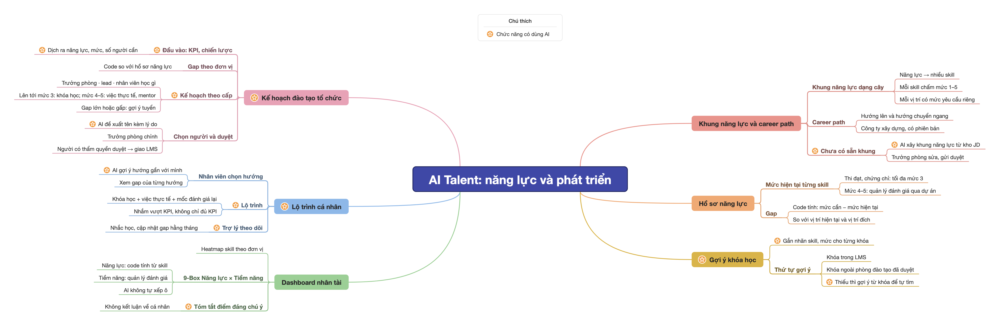
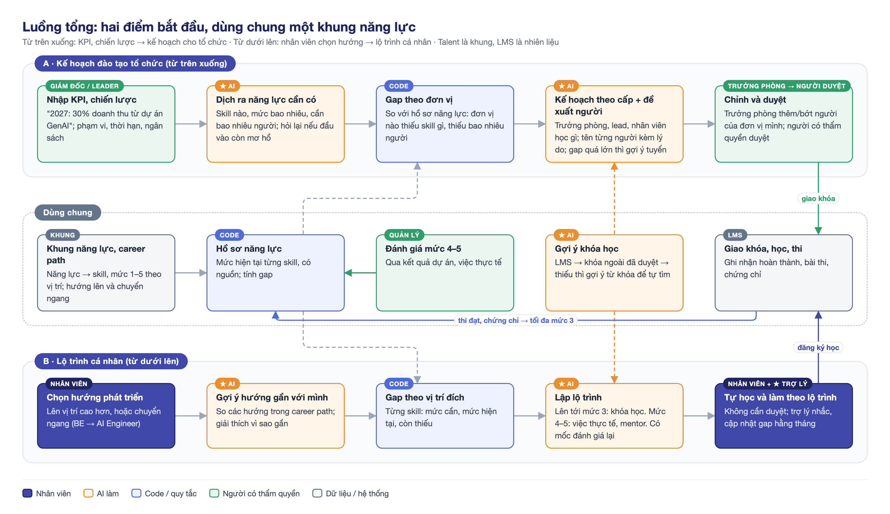
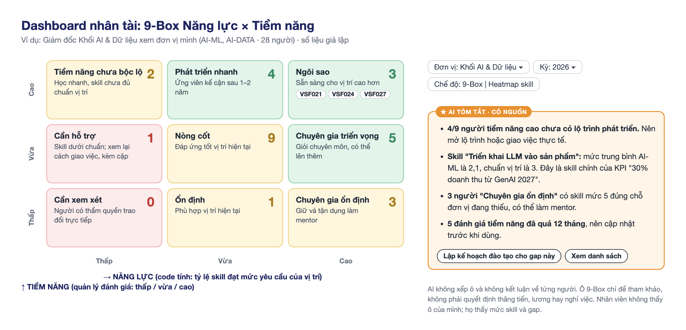

# AI Talent: năng lực và phát triển nhân sự

> **Trạng thái:** đã chốt qua brainstorm ngày 17/11/2026, chờ review.
> **Phạm vi:** khung năng lực và career path, hồ sơ năng lực và gap, kế hoạch đào tạo cho tổ chức, lộ trình cá nhân, gợi ý khóa học, dashboard 9-Box. Không làm phần nội dung khóa học (soạn khóa, AI Tutor, sinh đề thi); phần này thuộc LMS (mục 11).
> **Bước sau:** user story ([talent-user-stories.md](talent-user-stories.md)) → màn hình.

---

## 1. Mục tiêu

| Ai | Vấn đề | AI Talent giúp gì |
|---|---|---|
| Giám đốc, leader | Có KPI và chiến lược nhưng không biết đội ngũ đang thiếu năng lực gì, cần đào tạo ai, học gì | Từ KPI ra năng lực cần có, gap theo đơn vị và kế hoạch đào tạo theo từng cấp, có tên người kèm lý do |
| Trưởng phòng | Chọn người đi học theo cảm tính; không thấy toàn cảnh năng lực của đơn vị | Danh sách đề xuất để chỉnh; heatmap skill và 9-Box của đơn vị |
| Nhân viên | Muốn phát triển nhưng không rõ hướng nào hợp, cần học gì, học xong thì được gì | Chọn hướng trên career path, thấy gap từng skill, có lộ trình gồm khóa học và việc thực tế |
| Phòng đào tạo | Danh mục khóa học không gắn với năng lực; khó chứng minh đào tạo có tác dụng | Khóa được gắn nhãn skill và mức; thấy skill nào đang thiếu khóa |

**Nguyên tắc:**
- **Talent là khung, LMS là nhiên liệu.** Talent quyết định cần học gì và vì sao. LMS cung cấp khóa học, bài thi, chứng chỉ và trả kết quả về.
- **Học và thi chỉ đưa tới mức 3.** Học xong chưa có nghĩa là đạt: mức chỉ tăng khi thi đạt hoặc có chứng chỉ. Mức 4–5 cần việc thực tế, nên kế hoạch cho gap cao phải có giao việc và mentor, không chỉ có khóa học.
- **Mục tiêu là vượt KPI, không chỉ đủ KPI.** Lộ trình nhắm tới mức của vị trí kế tiếp, không dừng ở mức vị trí hiện tại.
- **Chỗ nào quy tắc làm chính xác được thì dùng code.** AI dịch KPI ra năng lực, gợi ý, viết kế hoạch và tóm tắt. Người có thẩm quyền duyệt. AI không xếp loại nhân viên.

---

## 2. Mind map

```text
AI Talent: năng lực và phát triển
├── A. Khung năng lực và career path
│   ├── F01 Khung dạng cây: năng lực → skill, mức 1–5, mức yêu cầu theo vị trí
│   ├── F02 Career path: hướng lên và hướng chuyển ngang giữa các vị trí
│   └── F03 Chưa có sẵn khung thì AI xây khung năng lực từ kho JD
├── B. Hồ sơ năng lực
│   ├── F04 Mức hiện tại từng skill, có nguồn (khóa, thi, chứng chỉ, quản lý đánh giá)
│   └── F05 Gap so với vị trí hiện tại và vị trí đích (code tính)
├── C. Kế hoạch đào tạo tổ chức (agent)
│   ├── F06 Từ KPI, chiến lược → năng lực, mức, số người cần
│   ├── F07 Gap theo đơn vị → kế hoạch theo cấp (trưởng phòng, lead, nhân viên)
│   ├── F08 Đề xuất người kèm lý do → trưởng phòng chỉnh → duyệt → giao sang LMS
│   └── F09 Theo dõi tiến độ học và mức skill thay đổi
├── D. Lộ trình cá nhân
│   ├── F10 Nhân viên chọn hướng; AI gợi ý hướng gần, so gap từng hướng
│   ├── F11 Lộ trình: khóa học + việc thực tế + mốc đánh giá lại
│   └── F12 Trợ lý theo dõi, nhắc, cập nhật gap
├── E. Gợi ý khóa học
│   ├── F13 AI gắn nhãn skill và mức cho khóa trong danh mục
│   └── F14 Gợi ý theo thứ tự: LMS → khóa ngoài đã duyệt → từ khóa để tự tìm
└── F. Dashboard nhân tài
    ├── F15 Heatmap skill theo đơn vị
    └── F16 9-Box Năng lực × Tiềm năng; AI tóm tắt điểm đáng chú ý
```

**Bản màu:**



Sơ đồ vẽ bằng HTML ở `images/src/`; sửa file HTML rồi chạy `bash images/src/render.sh`.

---

## 3. Luồng tổng



Hai luồng có hai điểm bắt đầu khác nhau, nhưng dùng chung khung năng lực, hồ sơ năng lực, phần gợi ý khóa học và LMS. Kết quả học ở cả hai luồng đều quay về hồ sơ năng lực, nên lần tính gap sau tự cập nhật.

| Việc | AI | Code / quy tắc | Con người |
|---|---|---|---|
| Khung năng lực | Chưa có sẵn khung thì xây từ kho JD | Lưu phiên bản, ngày hiệu lực | Công ty duyệt khung và career path |
| Mức hiện tại | — | Thi đạt, chứng chỉ trong LMS tự cập nhật mức, tối đa 3 | HR xác nhận chứng chỉ ngoài; quản lý đánh giá mức 4–5 |
| Gap | — | Mức cần − mức hiện tại, theo người và theo đơn vị | — |
| KPI → năng lực | Dịch KPI, chiến lược ra skill, mức, số người; hỏi lại khi mơ hồ | — | Giám đốc xác nhận cách hiểu |
| Kế hoạch | Viết kế hoạch theo cấp, đề xuất người kèm lý do | Lọc người theo gap, vị trí | Trưởng phòng chỉnh; người có thẩm quyền duyệt |
| Lộ trình cá nhân | Gợi ý hướng gần, lập lộ trình, trả lời trong chat | Gap theo vị trí đích, nhắc, mốc đánh giá lại | Nhân viên chọn hướng |
| Khóa học | Gắn nhãn skill, mức; gợi ý; gợi ý từ khóa để tự tìm | Lọc theo nhãn đã duyệt | Phòng đào tạo duyệt nhãn và danh mục khóa ngoài |
| 9-Box | Tóm tắt điểm đáng chú ý theo đơn vị | Tính trục Năng lực; đếm theo ô | Quản lý đánh giá trục Tiềm năng |

---

## 4. Khung năng lực và hồ sơ năng lực

### 4.1 Khung dạng cây

Mỗi vị trí có một cây năng lực. Mỗi năng lực gồm nhiều skill, mỗi skill có mức yêu cầu từ 1 đến 5. Ví dụ cho vị trí **Kỹ sư AI (AI-ML)**:

```text
Kỹ sư AI
├── Năng lực: Kỹ thuật học máy
│   ├── Python cho ML ............................ mức yêu cầu 3
│   ├── Huấn luyện và đánh giá mô hình ........... 3
│   └── Triển khai LLM vào sản phẩm ............... 3
├── Năng lực: Hạ tầng và vận hành mô hình
│   ├── Cloud (AWS / Azure) ....................... 2
│   └── MLOps ...................................... 2
└── Năng lực: Làm việc nhóm
    ├── Viết tài liệu kỹ thuật ..................... 3
    └── Trình bày với khách hàng ................... 2
```

Khung năng lực và career path do công ty xây dựng và duyệt, có phiên bản và ngày hiệu lực. Hệ thống chỉ dùng bản đã duyệt.

**Chưa có sẵn khung:** AI xây khung năng lực từ kho JD và mô tả công việc của từng vị trí. Ví dụ JD ghi "thành thạo Python" thì ra skill Python mức 3; JD ghi "AWS là lợi thế" thì ra Cloud mức 2. Trưởng phòng sửa rồi gửi duyệt, không phải viết từ đầu.

### 4.2 Thang mức và nguồn điểm

| Mức | Mô tả chung (giả định, cần chốt) | Nguồn điểm |
|---|---|---|
| 1 | Biết khái niệm | Thi đạt bài thi của khóa có nhãn mức 1 |
| 2 | Làm được khi có hướng dẫn | Thi đạt bài thi của khóa có nhãn mức 2 |
| 3 | Làm độc lập | Thi đạt bài thi mức 3, hoặc chứng chỉ bên ngoài (AWS, Microsoft…) đã được HR xác nhận |
| 4 | Xử lý việc khó, hướng dẫn được người khác | Quản lý đánh giá qua dự án, việc thực tế |
| 5 | Chuyên gia, định hướng cho đơn vị | Quản lý đánh giá qua dự án, việc thực tế |

Học xong khóa không có bài thi chỉ được ghi "đã học" trong hồ sơ, không đổi mức.

Bản này chỉ ghi cách đánh giá mức 4–5 làm bối cảnh: quản lý hoặc cấp trên đánh giá qua kết quả dự án. Quy trình chi tiết chưa nằm trong phạm vi (mục 11).

**Mức ban đầu:** khi bắt đầu dùng, hồ sơ năng lực còn trống. Mức ban đầu lấy từ chứng chỉ đã được HR duyệt ở onboarding, cộng với một vòng nhân viên tự đánh giá và quản lý xác nhận. Skill chưa có dữ liệu ghi "chưa đánh giá", không coi là mức 0.

### 4.3 Gap

Gap = mức yêu cầu − mức hiện tại, do code tính cho từng skill. Gap tính theo hai mốc:
- **Vị trí hiện tại:** để làm đủ việc.
- **Vị trí đích:** vị trí kế tiếp trên career path, hoặc vị trí nhân viên chọn. Mốc này dùng để vượt KPI.

Gộp theo đơn vị, gap cho biết đơn vị thiếu skill gì và thiếu bao nhiêu người đạt mức.

---

## 5. Kế hoạch đào tạo tổ chức

**Hai điểm bắt đầu:** từ KPI, chiến lược (đủ các bước dưới đây), hoặc từ một gap trên dashboard (mục 8). Bắt đầu từ dashboard thì phạm vi và skill đã có sẵn, bỏ qua bước 1–2.

**Các bước:**
1. Giám đốc hoặc leader nhập KPI, chiến lược, phạm vi đơn vị, thời hạn và ngân sách nếu có.
2. AI dịch ra năng lực cần có: skill, mức, số người. Đầu vào mơ hồ thì AI hỏi lại. Giám đốc xác nhận cách hiểu trước khi đi tiếp.
3. Code so với hồ sơ năng lực, tính gap theo đơn vị.
4. AI lập kế hoạch theo cấp và đề xuất tên từng người kèm lý do.
5. Trưởng phòng thêm hoặc bớt người của đơn vị mình. Người có thẩm quyền duyệt kế hoạch.
6. Hệ thống giao khóa sang LMS, tạo việc thực tế và ghép mentor theo kế hoạch.
7. Theo dõi tiến độ học và mức skill thay đổi. AI tóm tắt định kỳ cho người duyệt. Không coi KPI thay đổi là tác động riêng của đào tạo.

**Ví dụ:** KPI "2027: 30% doanh thu từ dự án GenAI".

| Cấp | Cần gì | Hình thức | Ai (AI đề xuất) |
|---|---|---|---|
| Trưởng phòng PM-BE, AI-ML | Đánh giá cơ hội GenAI, quản trị rủi ro AI | Khóa ngoài đã duyệt | 2 trưởng phòng |
| Lead | Kiến trúc hệ thống LLM: mức 3 → 4 | Dẫn dắt một dự án GenAI thử nghiệm, có mentor mức 5 kèm | 3 lead PM-BE có Kiến trúc hệ thống ≥ 3 |
| Nhân viên | Triển khai LLM vào sản phẩm: mức 1 → 3 | Khóa trong LMS + bài thi | 12 kỹ sư PM-BE, AI-ML đang ở mức 1–2 |
| — | 2 kỹ sư MLOps mức 4 trong 6 tháng | Không đào tạo kịp: gợi ý tuyển | Chuyển sang tuyển dụng |

**Hình thức theo gap:**

| Gap | Hình thức |
|---|---|
| Lên tới mức 3 | Khóa học có bài thi, chứng chỉ |
| Lên mức 4–5 | Việc thực tế (vai trò trong dự án), mentor ở mức cao hơn |
| Quá lớn so với thời hạn, hoặc không có ai ở gần mức cần | Gợi ý tuyển, chuyển sang tuyển dụng |

---

## 6. Lộ trình cá nhân

**Các bước:**
1. Nhân viên chọn hướng trên career path: lên vị trí cao hơn, hoặc chuyển ngang sang vị trí khác.
2. AI gợi ý các hướng gần với mình dựa trên skill hiện có, kèm gap của từng hướng. Chỉ gợi ý các vị trí có trong career path.
3. Nhân viên chọn một hướng. AI lập lộ trình gồm khóa học, việc thực tế nên xin nhận, và mốc đánh giá lại.
4. Lộ trình là gợi ý cho nhân viên, không cần ai duyệt. Nhân viên tự đăng ký khóa trong LMS; việc thực tế, mentor hay khóa ngoài có phí thì nhân viên tự trao đổi với quản lý. Trợ lý nhắc học, cập nhật gap hằng tháng và đề xuất chỉnh lộ trình khi mức skill thay đổi.

**Ví dụ:** Phạm Thu Hà, Kỹ sư Backend (PM-BE), phân vân giữa hai hướng.

| Hướng | Skill còn thiếu | Ước tính |
|---|---|---|
| **Kỹ sư AI** (chuyển ngang) | Huấn luyện và đánh giá mô hình 1 → 3 · Triển khai LLM vào sản phẩm 2 → 3 | Gần hơn: 2 skill, đều lên được bằng khóa học |
| **Tech Lead** (hướng lên) | Kiến trúc hệ thống 3 → 4 · Dẫn dắt nhóm 1 → 4 | Xa hơn: cần việc thực tế, khoảng 12–18 tháng |

Lộ trình cho hướng Kỹ sư AI: 1 khóa trong LMS cho Huấn luyện và đánh giá mô hình, 1 khóa ngoài đã duyệt cho Triển khai LLM, nhận một task tích hợp LLM trong dự án hiện tại, đánh giá lại sau 3 tháng.

---

## 7. Gợi ý khóa học

| Thứ tự | Nguồn | Ghi chú |
|---|---|---|
| 1 | Khóa trong LMS | Phòng đào tạo quản lý |
| 2 | Khóa ngoài trong danh mục phòng đào tạo đã duyệt (Coursera, chứng chỉ AWS, Microsoft…) | Có chi phí thì đi theo duyệt kế hoạch |
| 3 | Vẫn thiếu: AI gợi ý **từ khóa để nhân viên tự tìm hiểu** | Không gợi ý link khóa cụ thể ngoài danh mục. Skill bị thiếu khóa được báo cho phòng đào tạo |

**Gắn nhãn:** khóa trong LMS thường chưa gắn với skill. AI đọc mô tả và nội dung khóa để đề xuất skill và mức khóa đưa tới; phòng đào tạo duyệt nhãn. Khóa chưa được duyệt nhãn không được dùng để gợi ý.

---

## 8. Dashboard nhân tài và 9-Box



| Trục | Nguồn | Cách tính |
|---|---|---|
| **Năng lực** | Hồ sơ năng lực | Code tính tỷ lệ skill đạt mức yêu cầu của vị trí hiện tại, trên các skill đã đánh giá. Chỉ xếp lên 9-Box khi ≥ 70% skill của vị trí đã được đánh giá; chưa đủ thì ghi "chưa đủ dữ liệu". Thấp / vừa / cao theo ngưỡng cấu hình (giả định < 60%, 60–89%, ≥ 90%) |
| **Tiềm năng** | Quản lý đánh giá | Thấp / vừa / cao. AI đưa căn cứ tham khảo: tốc độ tăng mức skill trong 12 tháng, đang theo lộ trình nào, khoảng cách tới vị trí kế tiếp |

**Heatmap skill:** mức trung bình từng skill theo đơn vị, so với chuẩn vị trí.

**AI tóm tắt điểm đáng chú ý:**
- người tiềm năng cao chưa có lộ trình;
- skill thiếu nhiều nhất so với KPI hiện tại;
- người có skill mức cao có thể làm mentor;
- đánh giá tiềm năng đã cũ.

Mỗi điểm kèm số liệu và nguồn. AI không kết luận về từng người. Từ dashboard, người xem bấm "Lập kế hoạch đào tạo" để mở luồng ở mục 5.

**Quyền xem:**

| Ai | Thấy gì |
|---|---|
| Ban điều hành, HR | Toàn công ty |
| Trưởng khối, trưởng phòng | Đơn vị mình |
| Nhân viên | Mức skill và gap của mình; không thấy ô 9-Box của mình |

---

## 9. Quy tắc

| Mã | Quy tắc |
|---|---|
| BR01 | Chỉ dùng khung năng lực và career path đã duyệt, đúng phiên bản đang hiệu lực |
| BR02 | Mức skill chỉ tăng khi thi đạt hoặc có chứng chỉ (chứng chỉ ngoài cần HR xác nhận), tối đa mức 3. Học xong không thi chỉ ghi "đã học". Mức 4–5 chỉ do quản lý đánh giá |
| BR03 | Mỗi mức skill lưu nguồn và ngày: khóa, bài thi, chứng chỉ, hay người đánh giá. Skill chưa có dữ liệu là "chưa đánh giá", không tính là mức 0 |
| BR04 | Gap do code tính. AI không tự đặt mức cho nhân viên |
| BR05 | Cách AI hiểu KPI, chiến lược phải được người nhập xác nhận trước khi lập kế hoạch |
| BR06 | Kế hoạch tổ chức chỉ giao sang LMS sau khi người có thẩm quyền duyệt. Trưởng phòng chỉ chỉnh người trong đơn vị mình |
| BR07 | Mỗi người được đề xuất phải có lý do gắn với gap cụ thể |
| BR08 | Gap cần lên mức 4–5 thì kế hoạch phải có việc thực tế hoặc mentor, không chỉ khóa học |
| BR09 | Gợi ý khóa theo thứ tự: LMS → khóa ngoài đã duyệt → từ khóa để tự tìm. Chỉ dùng khóa đã duyệt nhãn |
| BR10 | AI chỉ gợi ý hướng có trong career path |
| BR11 | AI không xếp ô 9-Box và không đánh giá tiềm năng. 9-Box không phải căn cứ duy nhất cho thăng tiến, lương, thưởng hay nghỉ việc |
| BR12 | Quyền xem dashboard theo cấp quản lý; nhân viên không thấy ô 9-Box của mình |
| BR13 | Không suy ra thiếu kỹ năng chỉ từ KPI thấp. KPI thấp là tín hiệu cần tìm hiểu |
| BR14 | Chỉ xếp một người lên 9-Box khi ≥ 70% skill của vị trí đã được đánh giá (ngưỡng cấu hình) |

---

## 10. Trường hợp biên cần xử lý

| # | Trường hợp | Xử lý |
|---|---|---|
| 1 | Vị trí chưa có khung năng lực | AI xây khung từ JD của vị trí đó; chưa duyệt thì không tính gap, chỉ hiện "khung chưa có" |
| 2 | Khung đổi phiên bản, mức yêu cầu thay đổi | Tính lại gap; kế hoạch và lộ trình đang chạy được báo để xem lại, không tự đổi |
| 3 | KPI không gắn với năng lực nào (ví dụ "giảm chi phí văn phòng 10%") | AI nói rõ không thấy năng lực liên quan, không ép ra kế hoạch đào tạo |
| 4 | Không có khóa nào cho một skill | Gợi ý từ khóa để tự tìm; báo phòng đào tạo skill đang thiếu khóa |
| 5 | Người được đề xuất đang quá tải dự án hoặc sắp nghỉ phép dài | Trưởng phòng bớt người; ghi lý do để AI không đề xuất lại người đó trong kế hoạch này |
| 6 | Chứng chỉ ngoài đã hết hạn | Mức do chứng chỉ đó đưa lên được đánh dấu "cần xác nhận lại" |
| 7 | Nhân viên chọn hướng mà gap rất lớn | Vẫn lập lộ trình, nói rõ thời gian ước tính và gợi ý hướng gần hơn |
| 8 | Nhân viên chuyển vị trí | Gap tính lại theo khung vị trí mới; mức skill đã có vẫn giữ |
| 9 | Đánh giá tiềm năng đã cũ (quá 12 tháng) | Ô 9-Box đánh dấu "dữ liệu cũ"; AI nhắc quản lý cập nhật |
| 10 | Đơn vị chưa có ai được đánh giá tiềm năng | 9-Box không hiển thị; chỉ hiện heatmap skill |
| 11 | Nhân viên còn nhiều skill "chưa đánh giá" | Không xếp lên 9-Box, ghi "chưa đủ dữ liệu"; AI nhắc quản lý những skill còn thiếu đánh giá |

---

## 11. Ngoài scope

| Không làm | Lý do |
|---|---|
| Soạn khóa học, AI Tutor, sinh đề thi, chấm bài | Thuộc LMS; Talent chỉ dùng kết quả |
| Quy trình chi tiết đánh giá mức 4–5 | Chưa rõ nghiệp vụ; bản này chỉ ghi quản lý đánh giá qua dự án |
| Quy trình KPI (đặt mục tiêu, chấm, thưởng) | Thuộc HRM; Talent chỉ đọc KPI làm đầu vào |
| Quyết định thăng tiến, lương, thưởng, nghỉ việc | Người có thẩm quyền quyết; 9-Box chỉ để tham khảo |
| AI tự đọc Jira, Git để chấm skill | Nhạy cảm, dễ bị hiểu là giám sát; chưa cần khi chưa rõ cách đánh giá mức 4–5 |
| AI tự xếp ô 9-Box, tự đánh giá tiềm năng | Đánh giá con người phải do người chịu trách nhiệm |

**Prototype:** khung năng lực, hồ sơ năng lực, danh mục khóa và KPI dùng dữ liệu giả lập của VinSmart Future. Gap và quy tắc mức làm bằng code. LMS và HRM là dữ liệu giả lập.

---

## 12. Phi chức năng

| Mã | Yêu cầu |
|---|---|
| NFR01 | Mọi gợi ý của AI đều có lý do và nguồn: skill nào, mức nào, lấy từ đâu, ngày nào |
| NFR02 | Kế hoạch cho một khối (≤ 100 người) hiện bản nháp trong ≤ 60 giây |
| NFR03 | Dữ liệu năng lực và tiềm năng là dữ liệu cá nhân, xử lý theo Luật Bảo vệ dữ liệu cá nhân; dịch vụ AI không được dùng để huấn luyện |
| NFR04 | Nhật ký: ai đổi mức skill, ai đánh giá tiềm năng, ai duyệt kế hoạch, lúc nào |
| NFR05 | Trợ lý nói rõ mình là AI; kết quả của AI luôn ghi là đề xuất |

---

## 13. Liên quan đến các phần khác

| Phần | Dùng chung |
|---|---|
| LMS | Danh mục khóa, giao khóa, kết quả học, thi, chứng chỉ |
| HRM | Vị trí, đơn vị, quản lý trực tiếp, KPI |
| Onboarding | Bằng cấp, chứng chỉ đã duyệt làm mức skill ban đầu |
| Tuyển dụng | Gap không đào tạo kịp thì gợi ý tuyển; người có skill phù hợp là ứng viên nội bộ |
| HR Agent | Trợ lý lộ trình cá nhân chạy trong bot HR trên app chat |

---

## 14. Còn cần hỏi mentor / HR

| # | Câu hỏi | Ảnh hưởng |
|---|---|---|
| 1 | Công ty đã có khung năng lực và career path chưa, ai đang giữ? | Mục 4, F01–F03 |
| 2 | Mô tả từng mức 1–5 có chuẩn chung không, hay mỗi khối tự định nghĩa? | Mục 4.2 |
| 3 | Mức 4–5 hiện được đánh giá thế nào, bao lâu một lần? | BR02, trục Năng lực |
| 4 | 9-Box công ty đang dùng trục Năng lực × Tiềm năng hay Hiệu suất × Tiềm năng? Ngưỡng thấp / vừa / cao là bao nhiêu? | Mục 8 |
| 5 | Phòng đào tạo có danh mục khóa ngoài đã duyệt chưa? Kế hoạch đào tạo và ngân sách do ai duyệt? | Mục 7, BR06 |
| 6 | KPI lưu ở đâu, có đọc được qua API không? | Mục 5 |
