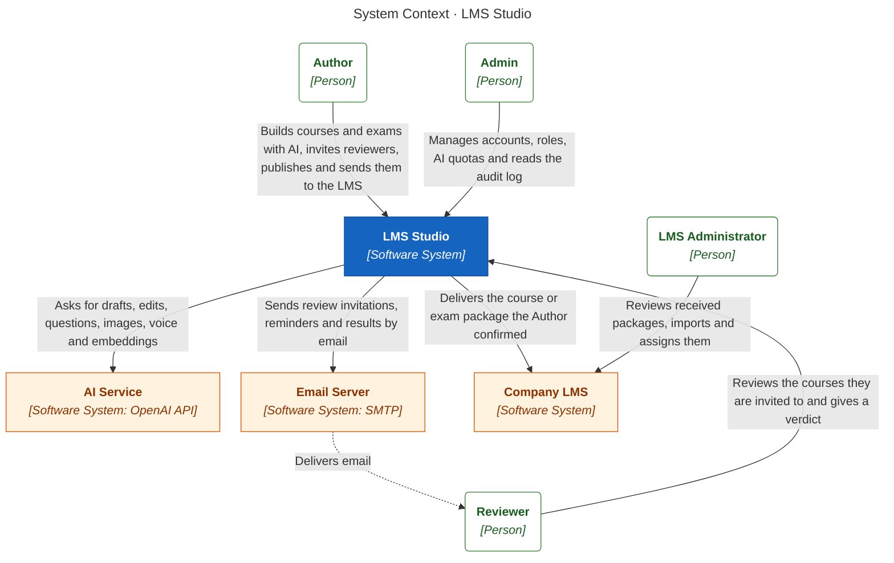
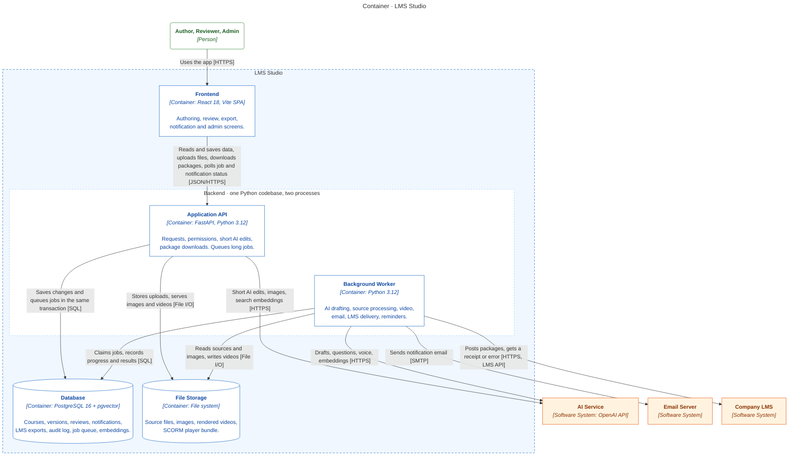
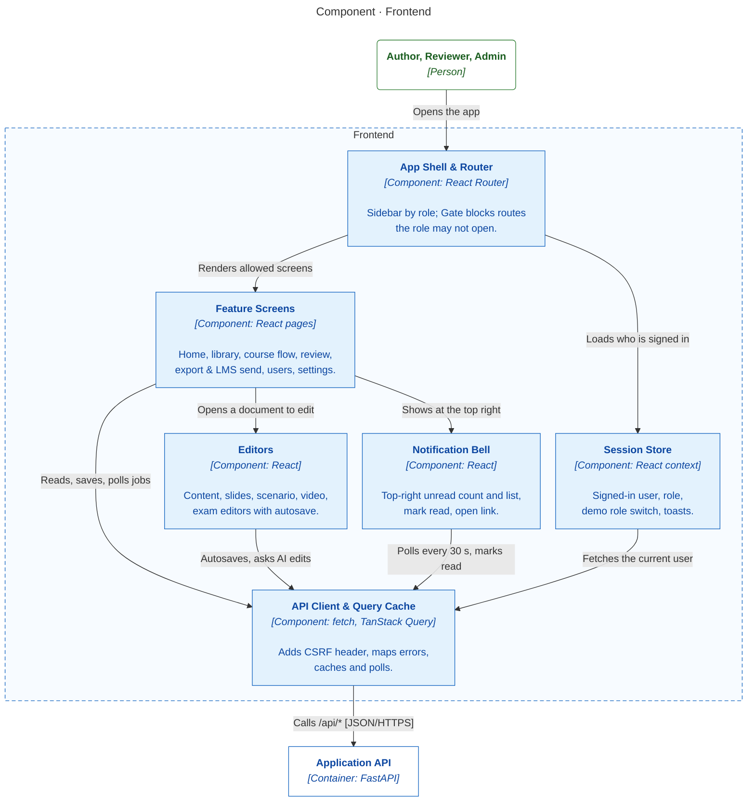
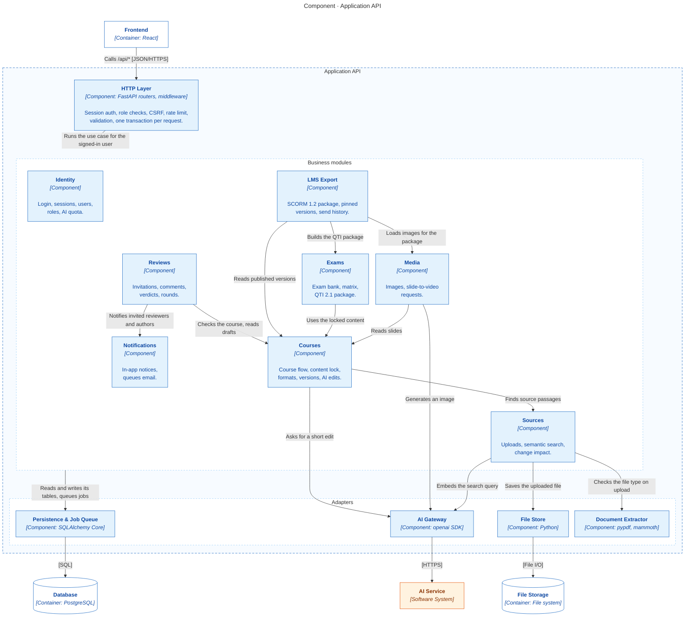

# Kiến trúc C4 · LMS Studio

> Mô tả hệ thống **đang chạy** trên nhánh `feat/lms-studio` (27/11/2026), không phải đề xuất. Chỗ nào môi trường phát triển khác production thì ghi rõ ở [mục 5](#5-phát-triển-và-production). Phạm vi và quyết định sản phẩm ở [STUDIO.md](STUDIO.md), cách xuất gói ở [INTEGRATION.md](INTEGRATION.md).

## 1. Cách đọc sơ đồ

Sơ đồ theo [ký hiệu của c4model.com](https://c4model.com/diagrams/notation), ba mức: **C1 System Context** (hệ thống và những ai, hệ thống nào dùng hoặc được nó gọi), **C2 Container** (các tiến trình chạy riêng và kho dữ liệu), **C3 Component** (phóng to một container). Không vẽ C4 Code vì code tự nói được.

| Ký hiệu | Nghĩa |
|---|---|
| Ô viền xanh lá | Person |
| Ô nền xanh đậm | LMS Studio (hệ thống trọng tâm ở C1) |
| Ô viền xanh nền trắng | Container. Ở C3 là container khác mà component trong hình gọi tới |
| Ô nền xanh nhạt | Component trong container đang phóng to |
| Hình trụ | Kho dữ liệu |
| Ô cam | Hệ thống bên ngoài, không do đội này làm |
| Khung nét đứt đậm | Ranh giới: hệ thống ở C2, container ở C3 |
| Khung nét đứt nhạt | Nhóm cho dễ đọc, không phải container: nhóm module, nhóm adapter |
| Mũi tên A → B | A chủ động gọi hoặc gửi tới B. Dữ liệu trả về đi ngược trên cùng kết nối, không vẽ thêm mũi tên. `[…]` là giao thức |

Nhãn trong sơ đồ bằng tiếng Anh theo thuật ngữ C4; giải thích bằng tiếng Việt trong bảng **Các mũi tên nghĩa là gì** dưới mỗi hình.

## 2. C1 · System Context

**LMS Studio** chỉ làm ra khóa học, không vận hành việc học. Người soạn dùng AI soạn khóa từ tài liệu nội bộ, mời reviewer góp ý, xuất bản có phiên bản, rồi đưa khóa (gói SCORM 1.2) và đề kiểm tra (QTI 2.1) sang **LMS công ty**. Nhân viên học và thi trên LMS công ty, không trên Studio.

### Các mũi tên nghĩa là gì

| Từ → Đến | Việc xảy ra |
|---|---|
| Author → LMS Studio | Tải tài liệu nguồn; tạo khóa (chi tiết → dàn ý → nội dung → chốt → định dạng); soạn câu hỏi, Kho đề; mời review, xử lý góp ý; xuất bản; tải gói hoặc gửi gói sang LMS |
| Reviewer → LMS Studio | Chỉ thấy khóa được mời. Xem bản nháp kèm đáp án, góp ý theo vị trí, kết luận Duyệt / Cần sửa. Nhận thông báo trong app (chuông) |
| Admin → LMS Studio | Mọi việc của Author, cộng quản trị người dùng, hạn mức AI, nhật ký |
| LMS Studio → AI Service | Gửi đoạn tài liệu nguồn hoặc nội dung đã chốt để nhận bản nháp (JSON theo schema), sửa một khối, câu hỏi, ảnh, giọng đọc, vector để tìm theo nghĩa. Kết quả AI luôn là bản nháp chờ người duyệt |
| LMS Studio → Email Server | Email mời review, mời review lại, nhắc hạn (trước 24 giờ), kết luận review, kết quả gửi LMS |
| Email Server ⇢ Reviewer | Email đến hộp thư (nét đứt: không phải Studio gọi trực tiếp) |
| LMS Studio → Company LMS | Gửi gói SCORM hoặc đề QTI đúng phiên bản Author đã xác nhận, nhận mã gói hoặc lỗi. Xuất bản trong Studio **không** tự gửi |
| LMS Administrator → Company LMS | Xem gói nhận qua API, nhập vào cổng đào tạo, giao cho nhân viên. Cách cũ vẫn dùng được: Author tải tệp .zip, quản trị LMS nhập tay |

**Không có trong hệ thống hiện tại** (đã cân nhắc, chưa làm): dịch vụ đăng nhập công ty (SSO/OIDC; hiện đăng nhập bằng email + mật khẩu trong Studio), kho tệp S3, SCORM 2004 / cmi5.

## 3. C2 · Container

### Các mũi tên nghĩa là gì

| Từ → Đến | Việc xảy ra | Giao thức |
|---|---|---|
| Người dùng → Frontend | Mở web, màn hình theo vai | HTTPS |
| Frontend → Application API | Mọi thao tác. Cookie phiên httpOnly; request ghi phải có header `x-lms` (chống CSRF). Tải tệp lên bằng multipart, tải gói về qua API. Tiến độ job, trạng thái gửi LMS và chuông thông báo lấy bằng **polling** (1–2 giây khi có job đang chạy, 30 giây cho chuông), không dùng SSE | JSON qua HTTPS |
| Application API → Database | Mỗi request ghi chạy trong một giao dịch (unit of work). Việc dài được xếp vào bảng `jobs` **cùng giao dịch** với thay đổi nghiệp vụ, nên không có job mồ côi hay thay đổi thiếu job | SQL (psycopg 3) |
| Application API → File Storage | Lưu tài liệu nguồn và ảnh tải lên; trả ảnh, video; đọc trình học SCORM khi đóng gói để tải về | Đọc/ghi tệp |
| Application API → AI Service | Việc ngắn người dùng chờ được: sửa một khối, thêm một bài, tạo ảnh, vector cho câu tìm kiếm. Mọi lần gọi trừ vào hạn mức AI tháng | HTTPS |
| Background Worker → Database | Nhận job bằng `for update skip locked` (nhiều luồng, nhiều tiến trình không giành nhau), ghi tiến độ ở giao dịch riêng để trình duyệt thấy ngay, thử lại 1 lần, job treo quá 10 phút được đưa lại hàng đợi | SQL |
| Background Worker → File Storage | Đọc tài liệu nguồn để trích chữ; đọc ảnh khi đóng gói; ghi video MP4 và phụ đề | Đọc/ghi tệp |
| Background Worker → AI Service | Soạn chi tiết, dàn ý, nội dung, định dạng, đề theo ma trận; vector cho đoạn tài liệu; giọng đọc cho video | HTTPS |
| Background Worker → Email Server | Gửi email thông báo. Trước khi gửi kiểm lại người nhận còn hoạt động và lời mời còn hiệu lực | SMTP |
| Background Worker → Company LMS | Dựng gói từ các phiên bản đã ghim lúc xác nhận, `POST /packages` với Bearer token và `Idempotency-Key` = mã lần gửi. 4xx: báo lỗi, không thử lại. 5xx / mất kết nối: thử lại rồi mới báo lỗi | HTTPS (LMS API) |

Vì sao API và Worker tách tiến trình mà dùng chung mã: soạn khóa bằng AI và dựng video mất hàng chục giây đến vài phút; chạy trong API sẽ giữ request và mất việc khi API khởi động lại. Hàng đợi nằm trong PostgreSQL nên không cần thêm Redis hay message broker ở quy mô này.

## 4. C3 · Component

Ba hình, mỗi hình một container. Backend xếp theo bốn tầng, đọc từ trên xuống, theo hướng phụ thuộc của Clean Architecture (tầng trên gọi tầng dưới, không gọi ngược):

1. **Lối vào**: HTTP routers (API) hoặc Job Runner (Worker).
2. **Business modules** (`app/modules/*`): quy tắc nghiệp vụ và bảng của mình. API và Worker chạy cùng mã nên module trùng tên ở hai hình là một.
3. **Adapters** (`app/adapters/*`, `app/shared/*`): nối với kỹ thuật bên ngoài. Module không gọi thẳng OpenAI, SMTP hay httpx.
4. **Container hoặc hệ thống khác** mà adapter gọi tới.

### 4.1 C3a · Frontend

| Từ → Đến | Việc xảy ra |
|---|---|
| App Shell & Router → Session Store, Feature Screens | Lấy người đang đăng nhập rồi dựng màn hình. Reviewer chỉ có Cần review và Cài đặt; Người dùng chỉ admin thấy. API vẫn kiểm quyền lại |
| Feature Screens → Editors | Mở tài liệu để soạn; trình soạn tự lưu, khôi phục phiên bản |
| Feature Screens, Editors → API Client | Đọc, ghi; theo dõi job AI bằng polling cho tới khi `done` / `failed` |
| Feature Screens → Notification Bell | Chuông ở góc trên bên phải của Trang chủ, Thư viện, Người dùng, Cài đặt, trang khóa và trang review (trình soạn toàn màn hình không có) |
| Notification Bell → API Client | Lấy `/api/notifications` 30 giây một lần và khi quay lại tab; bấm một thông báo thì đánh dấu đã đọc và mở trang liên quan |
| API Client → Application API | `fetch` cùng nguồn, gửi cookie và header `x-lms`; lỗi trả về dạng `{error: {code, message}}` |

Cùng mã giao diện học được build riêng thành **trình học SCORM** (`npm run build:scorm`, ra `apps/web/dist-scorm`). Trình học chạy trong gói, không gọi API mà đọc `course.js` đóng sẵn và báo kết quả qua `window.API` của LMS.

### 4.2 C3b · Application API

| Từ → Đến | Việc xảy ra |
|---|---|
| HTTP Layer → Business modules | Middleware kiểm `x-lms`, giới hạn 600 request/phút (đăng nhập 10/phút); router lấy người dùng từ cookie phiên (`current_user`, `require_editor`, `require_admin`), pydantic kiểm đầu vào (lỗi trả 400 `validation`), rồi gọi module trong một unit of work: thành công thì commit, lỗi thì rollback. Tài liệu API tự sinh ở `/api/docs` |
| Reviews → Courses, Notifications | Kiểm khóa và lời mời; mời, mời lại, kết luận, góp ý đều tạo thông báo cho đúng người. Góp ý liên tiếp của cùng người trên cùng khóa, khi người nhận chưa đọc, được gộp vào một dòng (cột `grouped`) |
| LMS Export → Courses, Exams, Media | Đọc **bản đã xuất bản** (hoặc phiên bản đã ghim khi gửi), bỏ Nội dung (chỉ dùng nội bộ) và đề chính thức khỏi gói SCORM; gói QTI do Exams dựng; ảnh lấy qua Media. Gửi sang LMS chỉ ghim phiên bản và xếp job `lms.send` |
| Exams → Courses | Đề soạn từ nội dung đã chốt; Courses dùng lại hàm thuần về ma trận đề (`exams.matrix`) khi kiểm tra lúc xuất bản |
| Courses → Sources | Tìm đoạn tài liệu theo nghĩa để làm căn cứ; báo tài liệu nào đang trích phần nguồn bị đổi |
| Courses, Media, Sources → AI Gateway | Việc ngắn người dùng chờ: sửa một khối, thêm bài, tạo ảnh, vector câu tìm kiếm. AI Gateway gom chính sách chung: model theo `.env`, hạn mức tháng, ghi token đã dùng, chế độ `mock` cho test |
| Modules → Persistence & Job Queue | Bảng định nghĩa ở `shared/tables.py`; `enqueue()` ghi job trong cùng giao dịch; nhật ký thao tác ở `audit_logs` |

Notifications không tự gửi email trong request: nó ghi thông báo và xếp job `email.send`, để request không phải chờ SMTP và lỗi email không làm hỏng thao tác chính.

### 4.3 C3c · Background Worker

```mermaid
---
title: Component · Background Worker
config:
  flowchart:
    wrappingWidth: 400
    nodeSpacing: 18
    rankSpacing: 48
    subGraphTitleMargin:
      bottom: 12
---
flowchart TB
  subgraph worker["Background Worker"]
    runner["<b>Job Runner</b><br/><i>[Component: 3 polling threads]</i><br/><br/>Claims queued jobs, runs each in a<br/>transaction, retries once."]
    house["<b>Housekeeping</b><br/><i>[Component: timer, every 60 s]</i><br/><br/>Requeues stale jobs,<br/>sends due-date reminders."]

    subgraph modules["Business modules"]
      sources["<b>Sources</b><br/><i>[Component]</i><br/><br/>source.process"]
      courses["<b>Courses</b><br/><i>[Component]</i><br/><br/>kit.outline, kit.draft,<br/>artifact.generate"]
      exams["<b>Exams</b><br/><i>[Component]</i><br/><br/>exam.generate"]
      media["<b>Media</b><br/><i>[Component]</i><br/><br/>video.render"]
      notifications["<b>Notifications</b><br/><i>[Component]</i><br/><br/>email.send, reminders"]
      export["<b>LMS Export</b><br/><i>[Component]</i><br/><br/>lms.send"]
    end

    subgraph adapters["Adapters"]
      persistence["<b>Persistence & Job Queue</b><br/><i>[Component: SQLAlchemy Core]</i>"]
      aiGw["<b>AI Gateway</b><br/><i>[Component: openai SDK]</i>"]
      extract["<b>Document Extractor</b><br/><i>[Component: pypdf, mammoth]</i>"]
      render["<b>Slide & Video Renderer</b><br/><i>[Component: resvg, ffmpeg]</i>"]
      store["<b>File Store</b><br/><i>[Component: Python]</i>"]
      mailer["<b>Mailer</b><br/><i>[Component: smtplib]</i>"]
      lmsClient["<b>LMS Client</b><br/><i>[Component: httpx]</i>"]
    end
  end

  ai["<b>AI Service</b><br/><i>[Software System]</i>"]
  mail["<b>Email Server</b><br/><i>[Software System]</i>"]
  lms["<b>Company LMS</b><br/><i>[Software System]</i>"]
  db[("<b>Database</b><br/><i>[Container: PostgreSQL]</i>")]
  files[("<b>File Storage</b><br/><i>[Container: File system]</i>")]

  runner -->|"Runs the job in the module that owns its kind"| modules
  runner ~~~ courses
  runner ~~~ export
  runner -->|"Claims jobs, records progress"| persistence
  house -->|"Finds reviews due within 24 h"| notifications
  house -->|"Requeues jobs stuck over 10 min"| persistence

  exams -->|"Reads the locked content"| courses
  courses -->|"Finds source passages"| sources
  export -->|"Builds packages from pinned versions"| courses
  export -->|"Tells the author the result"| notifications

  sources -->|"Reads text"| extract
  sources -->|"Embeds passages"| aiGw
  courses -->|"Drafts outline, content, formats"| aiGw
  exams -->|"Drafts questions"| aiGw
  media -->|"Asks for voice-over"| aiGw
  media -->|"Draws slides, encodes MP4"| render
  sources -->|"Reads the uploaded file"| store
  render -->|"Writes the video"| store
  notifications -->|"Sends the email"| mailer
  export -->|"Posts the package"| lmsClient
  modules -->|"Saves results"| persistence

  aiGw -->|"[HTTPS]"| ai
  mailer -->|"[SMTP]"| mail
  lmsClient -->|"[HTTPS, LMS API]"| lms
  persistence -->|"[SQL]"| db
  store -->|"[File I/O]"| files

  classDef component fill:#E3F2FD,stroke:#1565C0,color:#0D47A1
  classDef container fill:#FFFFFF,stroke:#1565C0,color:#0D47A1
  classDef external fill:#FFF3E0,stroke:#E65100,color:#8A3200
  class runner,house,sources,courses,exams,media,notifications,export,persistence,aiGw,extract,render,store,mailer,lmsClient component
  class db,files container
  class ai,mail,lms external
  style worker fill:#F7FBFF,stroke:#1565C0,stroke-dasharray:6 4
  style modules fill:#FFFFFF,stroke:#90CAF9,stroke-dasharray:4 4
  style adapters fill:#FFFFFF,stroke:#90CAF9,stroke-dasharray:4 4
```

| Từ → Đến | Việc xảy ra |
|---|---|
| Job Runner → Persistence | `claim()` bằng `for update skip locked`; chạy job trong một giao dịch; lỗi thì xếp lại (tối đa 2 lần chạy) rồi ghi `failed` kèm lý do. Tiến độ ghi ở giao dịch riêng |
| Job Runner → Business modules | Mỗi loại job do đúng một module đăng ký (`define_job`), ghi trong ô của module |
| Housekeeping → Notifications, Persistence | Mỗi 60 giây: nhắc reviewer còn hạn trong 24 giờ (mỗi vòng review nhắc một lần), đưa job treo quá 10 phút về hàng đợi |
| Sources → Document Extractor, AI Gateway | Trích chữ PDF / DOCX / TXT / MD, cắt đoạn, tạo vector (pgvector) |
| Courses, Exams → AI Gateway | Soạn dàn ý, nội dung có trích nguồn, các định dạng từ nội dung đã chốt, đề theo ma trận. Kết quả là bản nháp |
| Media → AI Gateway, Renderer | Lời đọc → giọng AI; slide → PNG (resvg) → MP4 có phụ đề (ffmpeg) |
| Notifications → Mailer → Email Server | Kiểm lại người nhận còn hoạt động và lời mời còn hiệu lực rồi mới gửi. `MAIL_TRANSPORT`: `smtp`, `console`, `memory` (test), `off` |
| LMS Export → LMS Client → Company LMS | Dựng gói từ phiên bản đã ghim, gửi kèm `Idempotency-Key` (gửi lại không tạo trùng), lưu mã gói hoặc lỗi; báo người gửi bằng thông báo và email |

## 5. Phát triển và production

| Thành phần | Máy phát triển (`npm start`) | Production |
|---|---|---|
| Frontend | Vite dev server cổng 5194, chuyển `/api` sang 4100 | Build tĩnh (`npm run build`), phục vụ qua reverse proxy cùng tên miền với API (cookie và CSRF dựa vào cùng nguồn) |
| Application API | `uvicorn --reload` cổng 4100, tự chạy migration Alembic khi khởi động | uvicorn sau reverse proxy HTTPS; chạy `python -m app.cli migrate` trước khi triển khai. Giới hạn số request đang đếm trong bộ nhớ của từng tiến trình: chạy nhiều tiến trình API thì chuyển bộ đếm sang Redis hoặc đặt giới hạn ở reverse proxy |
| Background Worker | `python -m app.worker`, 3 luồng | Một hoặc nhiều tiến trình (an toàn nhờ `skip locked`); cần ffmpeg |
| Database | PostgreSQL 16 + pgvector trong Docker, DB `lms_studio` | PostgreSQL quản lý, có sao lưu |
| File Storage | Thư mục `apps/api/storage` | Ổ dùng chung cho API và Worker (`STORAGE_DIR`). Nhiều máy chủ thì cần ổ mạng hoặc chuyển sang S3 (chưa làm) |
| AI Service | OpenAI theo key trong `.env`; `AI_PROVIDER=mock` khi không có key và trong test | OpenAI hoặc nhà cung cấp IT duyệt; hạn mức theo tháng |
| Email Server | **Mailpit** (Docker) nhận mọi thư, xem ở http://localhost:8025 | SMTP của công ty (`SMTP_HOST`, `SMTP_USER`, `SMTP_TLS`) |
| Company LMS | **LMS demo** `apps/company-lms` cổng 5196: API nhận gói `/lms-api/packages` và màn "Gói nhận qua API" | LMS thật của công ty, theo cùng hợp đồng API ([INTEGRATION.md](INTEGRATION.md#2-gửi-gói-qua-api)); khác hợp đồng thì chỉ thay LMS Client |

## 6. Đã sửa so với bản C4 trước

Bản trước là đề xuất; bản này khớp code. Những chỗ đổi:

| Bản trước | Hệ thống thật | Vì sao |
|---|---|---|
| Authentication Service (OIDC) | Không có. Đăng nhập email + mật khẩu, phiên lưu trong DB | Chưa có thông tin nhà cung cấp định danh của công ty |
| Notification Service bên ngoài | Thông báo trong app là module của Studio; chỉ **Email Server** là bên ngoài | Chuông, đã đọc / chưa đọc là dữ liệu của Studio |
| Object Storage (S3), signed URL | File Storage trên ổ đĩa; tải lên, tải về đi qua API | Một máy chủ đủ cho quy mô hiện tại |
| SSE cho AI và tiến độ job | Polling | Đơn giản, đủ nhanh (1–2 giây) cho thao tác nền |
| Question Bank tách riêng | Câu hỏi nằm trong tài liệu Đề kiểm tra; Kho đề là module Exams | Theo cách sản phẩm đang dùng |
| Quét mã độc (Scan & Extract) | Chỉ trích chữ, kiểm định dạng và dung lượng | Chưa có công cụ quét được IT duyệt |
| Job Stop | Chưa có | — |
